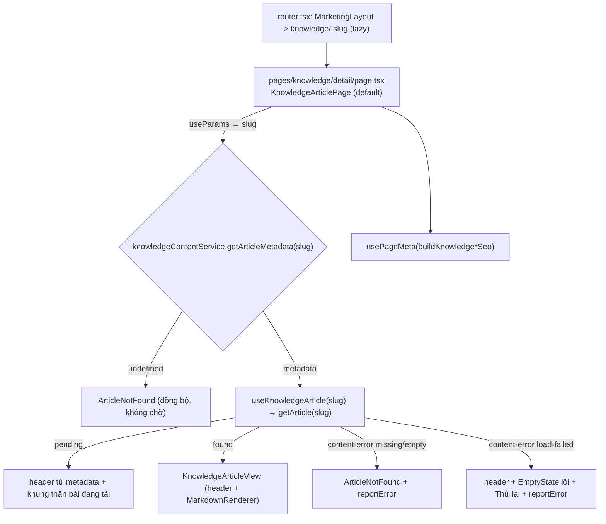

# AstroViet — Frontend Sprint F6.4: Article Detail Implementation Plan

| | |
|---|---|
| **Trạng thái** | **PLAN v1.0 — chờ Owner review.** Plan-only: không sửa mã, package, lockfile, cấu hình hay tài liệu nào trong repo; không cài dependency; không AC nào được ghi PASS |
| **Repo / nhánh đã audit** | `KhongphaiHphuc0705/astroviet`, nhánh `dev`, HEAD `e6de4d7` (2026-11-21, "[docs] update f6.3 evidence matrix & known gaps registry"); evidence commit F6.3 = `b0d1b16`, **Frontend CI #367 = Success** (link Owner cung cấp; tôi không đọc được log chi tiết vì cần đăng nhập) |
| **Ngày lập** | 2026-11-21 |
| **Vị trí đề xuất** | `docs/implementation/Sprint_F6.4_Article_Detail_Implementation_Plan.md` (tên theo prompt; plan milestone là tài liệu tạm, xoá khi đóng như F6.2/F6.3). Evidence Matrix: `docs/implementation/archive/sprint-f6/` |
| **Nhãn** | **[VF]** đã đọc/chạy trên bản clone · **[SPIKE]** thí nghiệm tạm ngoài repo (clone + `/tmp`, không commit) · **[AD]** Owner đã duyệt · **[REC]** đề xuất mới, **cần Owner duyệt** · **[UNK]** chưa biết · **[PLAN]** dự kiến |

---

## 1. Executive Summary

**Mục tiêu F6.4.** Trang công khai `/knowledge/:slug`: `KnowledgeArticleView` (header: tiêu đề `h1`, danh mục, ngày `dd/MM/yyyy`, liên kết `← Tất cả bài viết`; thân bài Markdown trong cột đọc ≈65ch), `ArticleNotFound`, xử lý lỗi nạp có phân loại, ảnh trong bài, và hook **`usePageMeta` dùng chung cho Listing + Detail** (title, description, canonical, `og:title/description/type/url`, `robots` cho not-found) có cleanup khi đổi route.

**Đã có từ F6.1–F6.3** [VF]: manifest + validate runtime + parity, `knowledgeContentService` (`listArticles`, `getArticleMetadata` đồng bộ; `getArticle` bất đồng bộ trả `found | not-found | content-error`), `MarkdownRenderer` (`skipHtml`, policy link/ảnh/heading, **chưa** nằm trong barrel), `seo.ts` thuần (`buildKnowledge{List,Article,NotFound}Seo`, `normalizeSiteUrl`), `formatKnowledgeDate`, `knowledgeArticlePath`, Listing (`/knowledge`) đã nghiệm thu kèm 14 ảnh viewport.

**F6.4 bổ sung:** route `/knowledge/:slug` (lazy), `KnowledgeArticleView`, `ArticleNotFound`, hook `useKnowledgeArticle`, `usePageMeta`, `resolveSiteUrl` + `VITE_SITE_URL` (phía client), sửa `text-body-md` còn sót trong `MarkdownRenderer`, tích hợp `usePageMeta` vào Listing (thay đổi tối thiểu), test + E2E + đo 65ch, tài liệu.

**Kết quả audit (tôi tự chạy ở `e6de4d7`)** [VF]: `lint`, `typecheck` sạch; **full suite 163 file / 1.373 test pass**; test KB + pages + router: 179/179; build 2.171 module — entry `index-*.js` **459.085 B raw / 145.134 B gzip**, chunk Listing **8.821 B / 3.747 B gzip** (không có thư viện markdown vì chưa route nào import renderer). Các lỗi nhỏ tôi nêu khi review F6.3 đã được sửa (thẻ `Cập nhật <time>`, `Ref<HTMLElement>`, `exact: true` ở E2E, gate `useSearchParams`).

**Không có blocker xác nhận** (mục 9.1). Có **11 quyết định Owner** kèm mặc định đề xuất (mục 10); không quyết định nào chặn F6.4.1.

**Cần chú ý trước khi code.** (1) `MarkdownRenderer` còn dùng `text-body-md` ở `p/ul/ol/li` — vi phạm KB-AC-21 và D-F6-X1; (2) F6 plan đặt `VITE_SITE_URL` ở F6.5 nhưng `usePageMeta` (F6.4) cần `siteUrl` ⇒ phải chuyển phần client sang F6.4; (3) bài mẫu duy nhất không có danh sách/blockquote/link/ảnh ⇒ không đủ để kiểm chứng typography; (4) không có `ScrollRestoration` nên mở bài từ Listing giữ nguyên vị trí cuộn; (5) E2E "đổi A→B" cần ≥2 bài.

---

## 2. Repository Audit & Current State

### 2.1 Tài liệu đã đọc [VF]
PRD (FR-12/13/14); Architecture Spec (§4.2, §5.1, §12.3); Coding Standards (§3.4, §4.2, §14.3, §13); UI Spec (§12.6 mẫu `max-w-[65ch]`, §13 hàng 14 `/knowledge/:slug`, dòng 999 `KnowledgeDetailPage`, §1180 ảnh lazy); `Sprint_F6_Implementation_Plan.md` (đã đồng bộ sau F6.3: §6.4 typography, §6.5 bảng trang, §7 F6.4, RTM KB-AC-02/04/05/19–25); Matrix F6.0–F6.3, Known Gaps Registry; prompt F6.4. **Không có** tài liệu glossary/localization riêng.

### 2.2 Mã đã kiểm tra & có thể tái dùng
| Hạng mục | Vị trí / ký hiệu | Dùng cho F6.4 |
|---|---|---|
| Router | `frontend/src/app/router.tsx`: nhóm `MarketingLayout` hiện có `index→HomePage` và `knowledge→KnowledgeListPage` (lazy); catch-all `*→NotFoundPage` (`h-screen`, `h1 "404"`) | thêm `knowledge/:slug`; `/knowledge/a/b` (2 đoạn) vẫn rơi vào `*` |
| Layout | `widgets/marketing-layout/index.tsx`: `Container as="main" id="main-content" tabIndex={-1}`, Navbar (chưa có "Kiến thức" — F6.5), Footer 1 dòng | dùng nguyên; không sửa |
| Service F6.2 | barrel `@features/knowledge-base`: `knowledgeContentService.{listArticles,getArticleMetadata,getArticle}`, `KnowledgeArticleMetadata`, `KnowledgeArticleResult` (`found/not-found/content-error{reason: missing-file|load-failed|empty-content}`), `KNOWLEDGE_CATEGORY_LABELS`, `buildKnowledge{List,Article,NotFound}Seo`, `normalizeSiteUrl`, `formatKnowledgeDate`, `knowledgeArticlePath`, `KNOWLEDGE_LIST_PATH` | **không** tạo manifest/loader/category/slug type thứ hai |
| Renderer | `features/knowledge-base/ui/MarkdownRenderer.tsx` (`markdown`, `isKnownSlug`, `className`); **không** trong barrel; heading `h1→h2`, `h5/h6→h4`; link nội bộ `Link`, ngoài `target=_blank rel="noopener noreferrer"`; ảnh chỉ `/knowledge/images/…`, `alt` bắt buộc, `loading=lazy decoding=async max-w-full h-auto`; **còn `text-body-md` ở `p`,`ul`,`ol`,`li` (4 chỗ)** | dùng; sửa lớp typography (D-F6.4-07) |
| SEO thuần | `model/seo.ts`: title `"{Tiêu đề} — AstroViet"`, `description=summary`, canonical `${siteUrl}/knowledge/${slug}`, OG `article`; list `website`; not-found `noindex` + không canonical; **không có trường `image`** | nguồn dữ liệu duy nhất cho `usePageMeta` và (F6.5) prerender |
| Ngày | `model/formatDate.ts`: `formatKnowledgeDate('YYYY-MM-DD')→'dd/MM/yyyy'` (tách chuỗi, không `Date`/`Intl`); giá trị lạ trả nguyên chuỗi; `updatedAt` kiểu `string`, manifest validate `YYYY-MM-DD` ngày lịch hợp lệ | dùng; bổ sung quy tắc hiển thị cho ngày lạ (mục 4.5) |
| Listing | `pages/knowledge/page.tsx` + `KnowledgeListView/ArticleCard/CategoryFilter`; thẻ link `knowledgeArticlePath(slug)` | chỉ thêm `usePageMeta` (minimal integration change) |
| UI chung | `EmptyState` (`headingLevel h2|h3` từ F6.3, `role=status`, `action`), `Button as={Link}`, `Badge`, `Skeleton`, `Spinner`, `Container`, `Stack`, `reportError(error, context)` (`shared/lib/report-error.ts`) | dùng; **không** thêm component chung mới ngoài hook |
| Dữ liệu | TanStack Query đã có (`createQueryClient`: `retry:false`, không `staleTime` mặc định); precedent trang chi tiết `pages/app/charts/detail/page.tsx` (`useParams` + `useQuery` + `EmptyState` + `document.title` trong `useEffect` có khôi phục — dòng 140–143) | `useKnowledgeArticle` dùng `useQuery` (không thêm thư viện) |
| Metadata hiện có | **không** có hook/thư viện (`react-helmet`… không có); `index.html` chỉ có `<title>AstroViet</title>`, **không** có `description/canonical/og`; router có TODO `OQ-M8-1` (title động) | tạo `usePageMeta` mới; không đóng OQ-M8-1 cho route khác |
| Env | `shared/config/env.ts`: zod `parse(import.meta.env)` chỉ có `VITE_API_BASE_URL`; `.env.example` chỉ 1 biến | thêm `VITE_SITE_URL` (D-F6.4-01) |
| Test infra | Vitest 4.1.10/jsdom, `renderWithProviders` (`ThemeProvider`+`QueryClient`+`MemoryRouter`), `vitest-axe`, MSW `onUnhandledRequest:"error"`; mẫu `app/router.test.tsx`; Playwright (CI chạy E2E thật), mẫu `e2e/knowledge-base.spec.ts` (4 test, mock `**/api/v1/auth/refresh`); Playwright browser **không** cài ở môi trường audit | evidence E2E lấy từ CI/máy Owner |
| Dependency | `react-markdown@10.1.0` (exact), **không** plugin markdown khác, **không** thư viện date/SEO | **0 dependency mới** |
| Nội dung | `content/fundamentals/what-is-astrology.md`: 1 `##`, 3 đoạn; **không** có list/blockquote/code/link/ảnh; `public/knowledge/` **chưa tồn tại** | cần fixture cho test (mục 7) |
| Tailwind | theme **thay thế** `colors/fontSize/fontFamily/borderRadius…`; `maxWidth` nằm trong `extend` ⇒ `max-w-prose` (65ch) và `max-w-[65ch]` đều sinh CSS [SPIKE]; `text-body-md/lg` có biến CSS không tồn tại (`tokens.css` định nghĩa `--font-size-body-*`, config tham chiếu `--text-body-*`) | chỉ dùng class đã kiểm bằng cổng CSS |

### 2.3 Thí nghiệm [SPIKE] phục vụ thiết kế
| # | Kiểm tra | Kết quả |
|---|---|---|
| S1 | Thứ tự effect khi đổi route (`createMemoryRouter` + `Suspense` + `lazy`): Listing → Article(a) → Article(b) → Listing, mỗi trang đặt `document.title` trong `useEffect` có cleanup khôi phục | log: `set:LIST → cleanup:LIST → set:ART-a → cleanup:ART-a → set:ART-b → cleanup:ART-b → set:LIST`; **cleanup luôn chạy trước effect của trang kế**, `title` cuối mỗi bước đúng ⇒ mẫu "chụp giá trị trước + khôi phục" an toàn cho các chuyển route thông thường |
| S2 | `vi.spyOn(knowledgeContentService, "getArticleMetadata")` | hoạt động (`Object.isFrozen === false`) ⇒ test nhiều bài **không** cần DI mới ở production |
| S3 | CSS thật cho class dự kiến | `max-w-prose`→`65ch`, `max-w-[65ch]`→`65ch`, `text-[16px]`, `[overflow-wrap:anywhere]`, `font-data`, `bg-surface-raised`, `border-subtle` **có**; `overflow-wrap-anywhere` **không có** (dùng arbitrary property) |
| S4 | Bundle baseline | mục 1 (entry 459.085 B; Listing 8.821 B) — mốc để so sau F6.4 |

### 2.4 Findings và chênh lệch (không chọn âm thầm)
| ID | Finding | Phân loại | Xử lý đề xuất |
|---|---|---|---|
| X1 | **`VITE_SITE_URL`/`resolveSiteUrl` đặt ở F6.5** (F6 plan §6.7, D-F6-P4, dòng 328/391) nhưng `usePageMeta` ở F6.4 cần `siteUrl` cho canonical/`og:url`. Prompt F6.4.4 liệt kê "Canonical URL và `VITE_SITE_URL` configuration contract" | Chênh lệch kế hoạch | Chuyển phần **client** (`env.ts` optional + `resolveSiteUrl`) sang F6.4; F6.5 giữ `PRERENDER_STRICT`, `loadEnv`, fail build — **D-F6.4-01** |
| X2 | F6 plan §6.2 đặt `lib/usePageMeta.ts` trong feature; Coding Standards §3.4 cấm tự thêm thư mục con ngoài `api/hooks/components/model` | Chênh lệch chuẩn | Đặt ở `shared/hooks/usePageMeta.ts` (hook DOM chung, không biết KB) — **D-F6.4-02** |
| X3 | `MarkdownRenderer` không nằm trong barrel (để cô lập `react-markdown`); Standards §14.3 yêu cầu import qua barrel, nhưng repo đã có import sâu (`@features/auth/hooks/…`) | Chênh lệch chuẩn | Trang chi tiết import **một** module sâu `@features/knowledge-base/ui/KnowledgeArticleView` (ngoại lệ có tài liệu, có regex gate) — **D-F6.4-03** |
| X4 | `text-body-md` trong `MarkdownRenderer` (`p/ul/ol/li`) | **Bug F6.2** (vi phạm KB-AC-21/D-F6-X1) | sửa ở F6.4.3 — phân loại *regression/bug fix có evidence* |
| X5 | Prompt §4.6 vừa yêu cầu `ArticleNotFound` khi "manifest có entry nhưng thiếu file", vừa cấm che lỗi hạ tầng thành Not Found | Mâu thuẫn trong yêu cầu | UI giống Not Found **nhưng** `reportError` + tách `reason` (mục 4.6) — **D-F6.4-04** |
| X6 | Không có `ScrollRestoration`/focus khi đổi route (`grep` toàn `src`); mở bài từ Listing giữ vị trí cuộn | Rủi ro UX mới | cuộn về đầu khi đổi `slug` ở trang chi tiết; focus/thông báo route giữ Known Gap `OQ-M8-1` — **D-F6.4-06** |
| X7 | Bài mẫu thiếu mọi phần tử cần kiểm (list, blockquote, code, link, ảnh); `summary` mẫu nhắc "lịch sử phát triển" nhưng thân bài không có phần lịch sử | Rủi ro bằng chứng / nội dung | fixture Markdown cho test; verify trực quan phần tử giàu ở F6.6 hoặc mở rộng bài mẫu (**D-F6.4-08**); lệch summary ghi Known Gap (F6.6) |
| X8 | `E2E đổi A→B` (Scenario D) cần ≥2 bài; manifest chỉ có 1 | Hạn chế dữ liệu | integration test + F6.6 (**D-F6.4-10**) |
| X9 | Prompt F6.4.7 yêu cầu cập nhật UI Spec/CHANGELOG ở F6.4; F6 plan D-F6-K (F6.7) và F6.2/F6.3 đã **không** sửa | Chênh lệch kế hoạch | giữ F6.7; ghi "as-built" vào Matrix F6.4 — **D-F6.4-09** |
| X10 | UI Spec gọi trang là `KnowledgeListPage`/`KnowledgeDetailPage`; code F6.3 export mặc định `KnowledgePage` (alias `KnowledgeListPage` ở router) | Đặt tên | detail: default export `KnowledgeArticlePage`, alias router `KnowledgeDetailPage` |
| X11 | `NotFoundPage` toàn cục dùng `h-screen` | Ghi nhận | `ArticleNotFound` **không** tái dùng; nằm trong `MarketingLayout` |

---

## 3. Requirement Traceability Matrix

Phân loại: **[O]** AC chính thức (RTM F6 plan §8, nguồn prompt sprint; PRD chỉ có FR-12/13/14) · **[AD]** quyết định đã duyệt · **[REC]** đề xuất cần Owner duyệt. Mọi trạng thái = **PENDING**.

| AC | Loại | Nguồn | Thiết kế | Task | Test | Evidence kỳ vọng |
|---|---|---|---|---|---|---|
| **KB-AC-02** Guest vào thẳng `/knowledge/:slug` | O | Spec §13 hàng 14 | route trong nhóm không guard | F6.4.2 | KB-U-route-5, KB-E02 | test route (guest/auth) + E2E direct URL |
| **KB-AC-04** Layout/nav công khai | O | Spec §13 | `MarketingLayout` | F6.4.2 | KB-U-route-5, KB-E02 | `nav "Điều hướng chính"` + `main#main-content` |
| **KB-AC-05** Slug lạ → Not Found, không crash, quay lại Listing | O | prompt | `ArticleNotFound` | F6.4.5 | KB-U09, KB-U40, KB-E08 | copy đúng + link `/knowledge` hoạt động |
| **KB-AC-19** Đúng một `h1` | O | prompt | header = `h1`; Markdown không sinh `h1` | F6.4.2 | KB-U15, KB-E06 | đếm `h1 === 1` (cả trạng thái loading/lỗi/not-found) |
| **KB-AC-20** Heading hợp lệ, bắt đầu H2 | O | prompt/F5 AC-24 | renderer (có sẵn) + lint nội dung | F6.4.2 | KB-U16 (+KB-U29 hiện có) | thứ tự heading DOM không nhảy cấp |
| **KB-AC-21** Cột đọc ≈65ch, responsive, không `text-body-md/lg` | O | D-F6-09 | `max-w-[65ch]` + `text-[16px]` ở **cùng** phần tử; sửa renderer | F6.4.3 | KB-U41, KB-E13, cổng CSS, `git grep` | **đo `getBoundingClientRect().width` so với probe `65ch`** (mục 4.8) + 0 `text-body-md/lg` |
| **KB-AC-22** Link nội bộ qua React Router | O | prompt | `Link` (có sẵn) | F6.4.2 | KB-U11 (có), KB-U42 | click → `location` đổi, không reload |
| **KB-AC-23** Link ngoài an toàn | O | D-F6-05 | `rel="noopener noreferrer"` (có sẵn) | F6.4.2 | KB-U11 (có), KB-U42 | thuộc tính `target/rel` |
| **KB-AC-24** Accessibility | O | F5 AC-24 | semantic, focus, tên link | F6.4.2–.6 | KB-A08…A10, KB-E06 | axe 0 critical/serious + QA bàn phím/thủ công |
| **KB-AC-25** Ảnh: alt, responsive, lazy | O | D-F6-12 | renderer `img` (có sẵn) | F6.4.3 | KB-U17 (có), KB-U43 | thuộc tính ảnh trên fixture |
| **AC-F6.4-A01** Ngày `dd/MM/yyyy` đúng, độc lập múi giờ | REC | prompt §4.4 | `formatKnowledgeDate` + quy tắc ngày lạ | F6.4.4 | KB-U34 (có) + KB-U44 | test `TZ` khác nhau |
| **AC-F6.4-A02** Listing & Detail dùng cùng `usePageMeta` | REC | prompt §4.5 | `shared/hooks/usePageMeta` | F6.4.4 | KB-U45, KB-U46 | `git grep` chỉ một hook |
| **AC-F6.4-A03** Metadata đổi đúng khi A→B; không rò sang route khác | REC | prompt §5 | cleanup/khôi phục | F6.4.4 | KB-U47, KB-U48 | `document.head` sau từng bước |
| **AC-F6.4-A04** Thiếu file ≠ Not Found "im lặng"; lỗi kỹ thuật không bị che | REC | prompt §4.6 | `classifyArticleResult` | F6.4.5 | KB-U49 | `reportError` gọi đúng `context` |
| **AC-F6.4-A05** Không render HTML thô trong thân bài | REC | prompt §5 | `skipHtml` (có sẵn) + KB-U10 | F6.4.6 | KB-U10 (có), KB-U50 | DOM không `script/on*` |
| **AC-F6.4-A06** Không có `og:image`; canonical không `//`/`/` cuối; `siteUrl` từ một nguồn | REC | D-F6-D1/P4 | `resolveSiteUrl` | F6.4.4 | KB-U51 | test thuần |
| **AC-F6.4-A07** Regression Listing & route hiện có | REC | prompt §5 | — | F6.4.6 | KB-U-route (cũ), KB-E01/E03/E04/E05/E11/E12 | CI |
**Không thuộc F6.4:** KB-AC-06 (Navbar/Footer, F6.5), 26–32 (SEO/prerender, F6.5), 36–40 (F6.6/F6.7).

---

## 4. Technical Design

### 4.1 Cấu trúc route và component

- **Khai báo route:** `router.tsx` — `const KnowledgeDetailPage = lazy(() => import("@pages/knowledge/detail/page"));` và `{ path: "knowledge/:slug", element: <KnowledgeDetailPage /> }` ngay sau route `knowledge`. Không đụng guard/route khác. `/knowledge/:slug` **không xung đột** `/knowledge` (đoạn khác nhau), `/` , `/login`, `/app/*`; slug `index`/`images` đã bị manifest cấm nên luôn thành Not Found.
- **Ai resolve slug:** `KnowledgeArticlePage` (`useParams<{slug:string}>()`), **không** `KnowledgeArticleView`. View là **thuần trình bày**: nhận `{ article: KnowledgeArticle, isKnownSlug }`; không hook dữ liệu ⇒ F6.5 prerender render trực tiếp view với bài đã nạp.
- **Tái dùng F6.2:** metadata đồng bộ qua `getArticleMetadata`; nội dung qua `getArticle` — **không** loader/manifest thứ hai.
- **Tên:** default export `KnowledgeArticlePage` (alias router `KnowledgeDetailPage` theo UI Spec dòng 999).

### 4.2 Luồng nạp nội dung — `useKnowledgeArticle(slug)` (`features/knowledge-base/hooks/useKnowledgeArticle.ts`)
- `useQuery({ queryKey: ["knowledge","article",slug], queryFn: () => knowledgeContentService.getArticle(slug), staleTime: Infinity, enabled: metadata !== undefined })`. Nội dung tĩnh/bất biến trong phiên ⇒ không refetch; `retry: false` mặc định hiện có; đổi `slug` ⇒ key mới, **không** lẫn nội dung bài cũ (KB-AC-19/20 của A→B).
- `queryFn` trả **kết quả union** (không ném): phân loại ở `classifyArticleResult` (mục 4.6) — giữ ngữ nghĩa F6.2 (`getArticle` không bao giờ ném).
- Metadata chờ không cần async ⇒ `h1`, danh mục, ngày, link quay lại **hiện ngay**; chỉ thân bài có trạng thái tải.
- Tương thích F6.5 (hydrate): `initialData` có thể lấy từ cache đồng bộ do `hydrate.ts` nạp trước — **không** triển khai ở F6.4 (YAGNI), chỉ ghi vào handoff (mục 12).

### 4.3 `KnowledgeArticleView` và khung đọc
```
<article class="mx-auto w-full max-w-[65ch] text-[16px] leading-relaxed [overflow-wrap:anywhere]">   ← cột đọc (65ch tính theo font 16px của CHÍNH phần tử này)
  <Link to="/knowledge">← Tất cả bài viết</Link>
  <header>  <Badge outline>{nhãn danh mục}</Badge>  <h1>{title}</h1>  <p>Cập nhật <time dateTime>{dd/MM/yyyy}</time></p>  </header>
  <MarkdownRenderer markdown isKnownSlug className="…"/>         ← thân bài kế thừa cỡ chữ; không đặt font-size riêng cho p/li
</article>
```
- **Summary không hiển thị** ở trang chi tiết (prompt §4.2.A: chỉ nếu Spec yêu cầu — UI Spec/F6 plan §6.5 không yêu cầu; summary dùng cho meta description). Không author/reading time/lượt xem.
- **Quay lại:** `Link` tới `KNOWLEDGE_LIST_PATH`; văn bản hiển thị đúng `← Tất cả bài viết`; mũi tên bọc `<span aria-hidden="true">` để tên truy cập là "Tất cả bài viết" (vẫn chứa trong nhãn hiển thị). Đặt **trên** `h1`; không breadcrumb.
- `h1` dùng class đã có ở F6.3 (`text-heading-lg md:text-display-lg font-bold text-primary`), `break-words`. Thân bài: `h2/h3/h4` của renderer (`text-heading-md/sm`).
- Một `h1` trong **mọi** trạng thái của trang (loading/lỗi/not-found).

### 4.4 Metadata — `usePageMeta` (`frontend/src/shared/hooks/usePageMeta.ts`) *(D-F6.4-02)*
```ts
export interface PageMeta {
  readonly title: string;
  readonly description?: string;
  readonly canonicalUrl?: string;
  readonly robots?: "noindex";
  readonly openGraph?: { readonly type: string; readonly title: string; readonly description: string; readonly url?: string };
}
export function usePageMeta(meta: PageMeta | null): void;   // chỉ useEffect (không động vào DOM khi render) ⇒ SSR-safe
```
- **Một cơ chế, hai trang (+ Not Found):** trang truyền kết quả `buildKnowledgeListSeo / buildKnowledgeArticleSeo / buildKnowledgeNotFoundSeo` (kiểu `KnowledgeSeo` của F6.2 **gán được cấu trúc** cho `PageMeta`; `shared` không import `features`). Dữ liệu meta chỉ có **một** nguồn (`seo.ts`) — F6.5 prerender cũng serialize chính các builder này.
- **Hành vi:** upsert `document.title`, `meta[name=description]`, `link[rel=canonical]`, `meta[property=og:title|og:description|og:type|og:url]`, `meta[name=robots]`; tag chưa có thì tạo (đánh dấu để gỡ), tag đã có thì nhớ giá trị cũ. **Cleanup** (khôi phục title cũ, gỡ tag đã tạo, trả giá trị cũ của tag có sẵn) chạy khi unmount **hoặc** khi `meta` đổi ⇒ chuyển bài A→B/Listing↔Article không để rò metadata; tag thiếu ở meta mới (vd. `canonical` của not-found) bị gỡ. Khoá phụ thuộc là chuỗi hoá các trường (không phụ thuộc identity object).
- **Không `og:image`** (D-F6-D1): kiểu `PageMeta` không có trường ảnh.
- **`siteUrl` rõ ràng (D-F6.4-01):** `features/knowledge-base/model/siteUrl.ts` — `resolveSiteUrl(raw: string | undefined, options: { isDev: boolean }): string | undefined` (thuần): có `raw` ⇒ `normalizeSiteUrl(raw)` (không hợp lệ ⇒ `undefined`, trang gọi `reportError` một lần); không có `raw` và `isDev` ⇒ `http://localhost:5173`; không có `raw` ở production ⇒ `undefined` ⇒ **không ghi canonical/`og:url`** (không đoán domain). Trang đọc `env.VITE_SITE_URL` (+ `import.meta.env.DEV`) và truyền `siteUrl` vào builder; builder `siteUrl` không đổi (đã chuẩn hoá). `env.ts`: `VITE_SITE_URL: z.string().optional()` (**không** `.url()` để một biến SEO sai không làm sập cả app lúc khởi động — kiểm tra ở `resolveSiteUrl`); `.env.example` thêm `VITE_SITE_URL=http://localhost:5173` (CI `cp .env.example .env`). **F6.5** vẫn sở hữu `PRERENDER_STRICT`, `loadEnv` cho Node, "fail build khi thiếu/sai", cảnh báo localhost ở production.
- **Canonical:** `${siteUrl}/knowledge/${slug}` / `${siteUrl}/knowledge` — không `//`, không `/` cuối (đã có trong `seo.ts`).
- **Tích hợp Listing (minimal integration change):** `pages/knowledge/page.tsx` thêm `usePageMeta(buildKnowledgeListSeo({siteUrl}))` (+ resolve `siteUrl`); `KnowledgeListView`/card/filter **không đổi**.
- **Rủi ro đã kiểm:** nhiều component ghi đè — chỉ `charts/detail/page.tsx` tự ghi `document.title` (route `/app`, độc lập); F6.4 **không** sửa file đó (ghi Known Gap: hợp nhất sau, ngoài phạm vi). Thứ tự cleanup→set đã xác minh [SPIKE S1].

### 4.5 Định dạng ngày
- `updatedAt: string` (kiểu `KnowledgeArticleMetadata`), giá trị manifest là **ISO date `YYYY-MM-DD`** (validate runtime: regex + ngày lịch UTC) [VF]. `formatKnowledgeDate` tách chuỗi (không `Date`) ⇒ không lệch múi giờ, không phụ thuộc ICU/locale.
- **Quy tắc ngày lạ (hiện chưa rõ):** hàm trả **nguyên chuỗi** khi không khớp `YYYY-MM-DD`, và hiện **không** kiểm ngày lịch (`2026-02-30` → `30/02/2026`). Đề xuất: (a) formatter kiểm ngày lịch bằng round-trip UTC tương tự `validateManifest` (sai ⇒ trả `""`), (b) view **ẩn dòng "Cập nhật"** khi kết quả rỗng và `reportError` một lần; **không** dùng ngày hiện tại thay thế. Manifest đã validate nên đây là phòng thủ; thay đổi `formatDate.ts` là *minimal integration change*. Test biên: `2026-11-21`, `2026-1-5` (lạ), `2026-02-29` (không nhuận), `2024-02-29`, rỗng, `2026-11-21T00:00:00Z` (datetime ⇒ lạ), chạy với `TZ=UTC`, `Asia/Ho_Chi_Minh`, `America/Los_Angeles`.

### 4.6 `ArticleNotFound` và phân loại lỗi — `classifyArticleResult` (pure, `model/articleViewState.ts`) *(D-F6.4-04)*
| Tình huống | Nguồn | Hiển thị | Báo cáo kỹ thuật |
|---|---|---|---|
| Slug không có trong manifest | `getArticleMetadata` = `undefined` (sync) hoặc `not-found` | `ArticleNotFound` | không (lỗi người dùng) |
| Entry có, **file thiếu** | `content-error/missing-file` | `ArticleNotFound` (người đọc không xử lý được) | **có**: `reportError(…, "knowledge-article:missing-file")` (lỗi toàn vẹn/build) |
| Entry có, **file rỗng/không hợp lệ** | `content-error/empty-content` | `ArticleNotFound` | **có**: `"knowledge-article:empty-content"` |
| **Lỗi nạp** (chunk/mạng) | `content-error/load-failed` | header (từ metadata) + `EmptyState` lỗi (`headingLevel="h2"`) + nút `Thử lại` (`refetch`) + link `← Tất cả bài viết` | **có**: `"knowledge-article:load-failed"` |
| Lỗi render bất ngờ | React | `RootErrorBoundary` hiện có (không bắt ở F6.4) | theo cơ chế hiện có |
- Hàm thuần trả `{ kind: "article" | "not-found" | "error"; report?: { context, error } }`; component gọi `reportError` trong `useEffect` (một lần theo `slug+reason`, tránh nhân đôi khi re-render/StrictMode).
- **Copy đã duyệt** (prompt §4.6 / F6 plan §14.3): `h1` `Không tìm thấy bài viết`; mô tả `Bài viết bạn tìm không tồn tại hoặc đã được di chuyển.`; nút `← Tất cả bài viết` (cùng cách xử lý mũi tên `aria-hidden`). **Copy trạng thái lỗi — đề xuất, chưa duyệt (D-F6.4-11):** tiêu đề `Không thể tải bài viết`, mô tả `Đã xảy ra lỗi khi tải nội dung. Vui lòng thử lại.`, nút `Thử lại`.
- `ArticleNotFound` **không** tái dùng `EmptyState` (cần `h1`, `EmptyState` chỉ `h2|h3`) nhưng dùng cùng token/`Button as={Link}`; nằm trong `MarketingLayout`; `usePageMeta(buildKnowledgeNotFoundSeo())` (`noindex`, không canonical). **Không** render bài khác thay thế; **không** endpoint Backend.
- **Giới hạn đã biết:** `import()` lỗi mạng có thể được trình duyệt cache thất bại ⇒ `Thử lại` không bảo đảm thành công — ghi Known Gap; không dựng cơ chế retry riêng.

### 4.7 Đổi route, cuộn và focus *(D-F6.4-06)*
- Trang chi tiết `useEffect(() => { window.scrollTo(0, 0); }, [slug])` (tức thời, không `smooth` ⇒ tôn trọng reduced-motion) và `key={slug}` cho `KnowledgeArticleView`. Không thêm `ScrollRestoration` toàn cục (ngoài phạm vi).
- **Focus/thông báo thay đổi trang** cho trình đọc màn hình: **không** đóng `OQ-M8-1` (F6 plan §6.5) — ghi Known Gap; QA bàn phím xác nhận không mất focus bất thường.

### 4.8 Typography và 65ch — *tiêu chí đo được*
- **Vùng:** `<article>` chứa **cả** back-link, header và thân bài chia sẻ một cột `max-w-[65ch]` (căn lề đồng nhất); ảnh `max-w-full` **không** rộng hơn cột; `pre`/bảng dài `overflow-x-auto` **trong** cột; URL/heading dài `[overflow-wrap:anywhere]`; cột `mx-auto` trong `Container` 1200px.
- **Vì sao đặt cỡ chữ ở chính cột:** `ch` tính theo font-size của phần tử có `max-width`; nếu cột 16px nhưng đoạn văn 17px thì dòng thực tế ≈ 61ch. ⇒ `text-[16px]` trên `<article>`, `p/ul/ol/li` **kế thừa** (bỏ `text-body-md` khỏi renderer); không dùng `text-body-md/lg` (D-F6-X1), không sửa token toàn cục. `max-w-[65ch]` chọn thay `max-w-prose` để khớp RTM/UI Spec §12.6 (cả hai = 65ch [SPIKE S3]).
- **Đo thật (KB-E13):** tại viewport 1280 và 1024: chèn phần tử probe `width:65ch; visibility:hidden; font:inherit` vào cột đọc → `|cột.width − probe.width| ≤ 1px`; tại 768 (nếu `container` hẹp hơn 65ch thì cột = bề rộng khả dụng) và 375/320: `cột.width ≤ viewport − 2×padding`, `scrollWidth ≤ clientWidth`; số ký tự trung bình/dòng của một đoạn dài nằm trong 45–80 (đo bằng `Range.getClientRects` hoặc ghi nhận thủ công). **Không** kết luận từ tên class.
- **Phần tử:** `h2/h3/h4` dùng chung cột; `p`, `ul/ol`, `blockquote`, `hr` dùng chung cột; code block cuộn ngang trong cột; ảnh ≤ cột.
- **Hạn chế:** bài mẫu không có list/blockquote/code/ảnh ⇒ đo thật chỉ phủ `h1/h2/p`; các phần tử còn lại kiểm bằng test fixture (class + cổng CSS) và trực quan ở F6.6, hoặc mở rộng bài mẫu nếu Owner duyệt (D-F6.4-08).

### 4.9 Hình ảnh
Convention F6.2 [AD D-F6.2-04]: chỉ `/knowledge/images/<tên>.(png|jpg|jpeg|webp|avif)` phục vụ từ `public/knowledge/images/` (chưa tồn tại — **không tạo thư mục/asset giả**); `alt` bắt buộc; `loading=lazy decoding=async`, `max-w-full h-auto`. Đường dẫn tương đối Markdown (`./x.png`) bị policy từ chối nên không có nguy cơ resolve sai. **Không** custom `onError`/skeleton ảnh ở MVP (ảnh là tài sản build-time; kiểm tồn tại file ở F6.6); ghi Known Gap: chưa có `width/height` ⇒ có thể dịch chuyển bố cục (CLS). Test bằng **fixture Markdown** (KB-U43): alt hợp lệ, `loading`, `max-w-full`, ảnh sai nguồn/alt rỗng không render.

### 4.10 Loading / error / accessibility / responsive
- **Loading:** route chunk dùng `SuspenseFallback` sẵn có; thân bài: khung `Skeleton`/`Spinner` nhỏ dưới header đã hiển thị; không flash Not Found cho slug hợp lệ.
- **A11y:** một `h1`; `article`/`header`/`time[datetime]`; link có tên truy cập rõ; focus-visible (token có sẵn); `prefers-reduced-motion` không thêm chuyển động; tương phản/Narrator là QA thủ công (jsdom không tính được).
- **Responsive:** 320/375/768/1024/1280, hai theme; không tràn ngang.

---

## 5. File-Level Implementation Plan

| File | Hành động | Vai trò / thay đổi | AC |
|---|---|---|---|
| `frontend/src/shared/hooks/usePageMeta.ts` + `.test.ts` | **Mới** | hook metadata chung (4.4) | A02, A03 |
| `frontend/src/features/knowledge-base/model/siteUrl.ts` + test | **Mới** | `resolveSiteUrl` thuần | A06 |
| `…/model/articleViewState.ts` + test | **Mới** | `classifyArticleResult` | 05, A04 |
| `…/hooks/useKnowledgeArticle.ts` (+ `query-keys`) + test | **Mới** | `useQuery` bọc `getArticle` | 02, 19 |
| `…/ui/KnowledgeArticleView.tsx` + test | **Mới** | header + thân bài + back-link, 65ch | 19–25 |
| `…/ui/ArticleNotFound.tsx` + test | **Mới** | trang Not Found trong layout | 05 |
| `frontend/src/pages/knowledge/detail/page.tsx` + test | **Mới** | resolve slug, state, meta, scroll | 02, 04, 05 |
| `frontend/src/app/router.tsx` | **Sửa (≈3 dòng)** | lazy + route `knowledge/:slug` | 02, 04 |
| `frontend/src/app/router.test.tsx` | **Sửa** | đổi KB-U-route-4 (`/knowledge/abc` nay là `ArticleNotFound`), thêm KB-U-route-5 | 02, 04, 05 |
| `frontend/src/pages/knowledge/page.tsx` + `page.test.tsx` | **Sửa (minimal integration)** | gọi `usePageMeta` Listing; thêm test meta | A02 |
| `frontend/src/features/knowledge-base/ui/MarkdownRenderer.tsx` | **Sửa (bug fix F6.2)** | bỏ `text-body-md` ở `p/ul/ol/li`, kế thừa cỡ chữ cột; giữ nguyên policy bảo mật | 21 |
| `frontend/src/features/knowledge-base/model/formatDate.ts` + test | **Sửa nhỏ** | kiểm ngày lịch (4.5) | A01 |
| `frontend/src/features/knowledge-base/index.ts` | **Sửa (thêm export)** | `ArticleNotFound`, `resolveSiteUrl`, `classifyArticleResult`, `useKnowledgeArticle`; **không** export `KnowledgeArticleView`/`MarkdownRenderer` | — |
| `frontend/src/features/knowledge-base/model/boundaries.test.ts` | **Sửa** | cho phép đúng một import sâu từ trang chi tiết; gate: Listing không import renderer/view | 12 |
| `frontend/src/shared/config/env.ts`, `frontend/.env.example` | **Sửa** | `VITE_SITE_URL` optional | A06 |
| `frontend/src/test/fixtures/knowledge-base/articles.ts` | **Mới** | Markdown fixture giàu phần tử (h2–h4, list, blockquote, code, link nội bộ/ngoài, ảnh hợp lệ/sai, HTML thô) | 20–25 |
| `frontend/e2e/knowledge-base.spec.ts` | **Sửa (mở rộng)** | Scenario A,B,C,E,F,G (+D khi ≥2 bài) | 02, 04, 05, 19, 21 |
| `docs/implementation/archive/sprint-f6/Sprint_F6_F6.4_Exit_Criteria_Evidence_Matrix.md`, `…Known_Gaps_Registry.md`, `…/evidence/` | **Mới/Sửa** | evidence | — |
| `docs/implementation/Sprint_F6_Implementation_Plan.md` | **Sửa** | ghi D-F6.4-*, chuyển phần client của `VITE_SITE_URL` sang F6.4, sửa `lib/`→`shared/hooks/` | — |
| **Giữ nguyên** | `MarketingLayout`, Navbar/Footer, `KnowledgeListView/ArticleCard/CategoryFilter`, `service/manifest/contentFiles/seo/markdownPolicy`, `charts/detail/page.tsx`, `tailwind.config.ts`, `tokens.css`, `package.json`/lockfile, `backend/**` | — | — |

---

## 6. Milestone / Task Breakdown

*Độ phức tạp S/M/L là ước lượng chủ quan; mỗi task commit riêng (`[feat]`/`[test]`/`[fix]`/`[docs]`).*

### F6.4.1 — Route & Integration Audit (S)
- **Mục tiêu:** xác nhận điều kiện vào, chốt contract, ghi baseline. **Input:** plan này. **Output:** bảng baseline (không sửa file).
- **Tasks:** git sạch; `.env`←`.env.example`; `npm ci`; `format:check`, `lint`, `typecheck`, `test`, `build`, `CI=1 npx playwright test --list`; ghi entry/Listing chunk (Phụ lục B); xác nhận API F6.2/F6.3 (mục 2.2) và **vị trí** `text-body-md` (`git grep`); lặp S1/S2 trong repo bằng test tạm không commit.
- **Acceptance/Verification:** baseline xanh (mốc: 163 file/1.373 test; entry 459.085 B; Listing 8.821 B; E2E 64/10 [Matrix F6.3]) hoặc sai lệch được giải thích. **DoD:** bảng baseline có SHA/ngày. **Rủi ro:** số liệu trôi theo advisory/commit.

### F6.4.2 — Route, Article Content Rendering & Navigation (M)
- **Dependencies:** F6.4.1. **Tasks:** `useKnowledgeArticle` (+key), `classifyArticleResult`, `KnowledgeArticleView`, trang chi tiết (resolve slug, đồng bộ Not Found, loading), route lazy, `index.ts`, regex gate import sâu, cập nhật `router.test.tsx`.
- **Output:** guest vào được bài; một `h1`; back-link; link nội bộ/ngoài đúng. **AC:** KB-AC-02, 04, 19, 20, 22, 23. **Verify:** KB-U15, U16, U42, KB-U-route-4/5, `git grep` import. **DoD:** test xanh; entry không đổi đáng kể; chunk chi tiết chứa markdown libs, chunk Listing **không** (Phụ lục B). **Rủi ro:** import sâu vô tình kéo renderer vào Listing; router test cũ phải đổi có chủ đích.

### F6.4.3 — Article Typography & Images (M)
- **Dependencies:** F6.4.2. **Tasks:** khung `article` `max-w-[65ch] text-[16px]`; sửa renderer (bỏ `text-body-md`); cuộn dài (`overflow-wrap`, `pre` cuộn trong cột); fixture Markdown; cổng CSS; đo 65ch (mục 4.8).
- **AC:** KB-AC-21, 25, 24 (một phần). **Verify:** KB-U41 (class + không `text-body-md/lg`), KB-U43 (ảnh), cổng CSS (Phụ lục A: 0 class thiếu), KB-E13 (đo thật) + ảnh 320…1280 × 2 theme do Owner/QA cung cấp. **DoD:** kết quả đo có số; thiếu ảnh viewport ⇒ AC-21 phần thị giác = **UNVERIFIED** (bài học F6.0b/F6.3). **Rủi ro:** `ch` lệch nếu font khác phần tử; font Inter tải chậm làm đổi `ch` — đo sau `document.fonts.ready`.

### F6.4.4 — Date Formatting & Page Metadata (M)
- **Dependencies:** F6.4.2 (trang), độc lập F6.4.3. **Tasks:** `formatDate` kiểm ngày lịch; `resolveSiteUrl`; `env.ts`/`.env.example`; `usePageMeta`; tích hợp Listing + Detail + Not Found; scroll-to-top.
- **AC:** A01, A02, A03, A06. **Verify:** KB-U44 (ngày/`TZ`), KB-U45–U48 (hook: tạo/cập nhật/gỡ tag, khôi phục title, không trùng tag, `meta=null`, A→B, Listing↔Article, unmount), KB-U51 (`resolveSiteUrl`), `git grep` chỉ một hook. **DoD:** `document.head` sạch sau khi rời KB; không `og:image`. **Rủi ro:** thứ tự effect (đã kiểm); StrictMode double-invoke; F6.5 hydrate với tag prerender (handoff).

### F6.4.5 — Article Not Found & Error Handling (S)
- **Dependencies:** F6.4.2. **Tasks:** `ArticleNotFound`; ánh xạ lỗi (4.6); `reportError` một lần; trạng thái lỗi + `Thử lại`.
- **AC:** KB-AC-05, A04. **Verify:** KB-U09/U40 (copy, link), KB-U49 (từng `reason`: `reportError` gọi/không gọi đúng `context`; spy trên `getArticle`), KB-E08. **DoD:** không crash; slug lạ không nạp async. **Rủi ro:** nhầm lỗi hạ tầng thành Not Found (đã tách bằng `reason`).

### F6.4.6 — Integration & Regression QA (M)
- **Dependencies:** F6.4.2–.5. **Tasks:** test tích hợp (`createMemoryRouter` + `routesConfig`); axe (KB-A08 trang chi tiết, A09 Not Found, A10 lỗi); E2E mục 7.3; hồi quy Listing + route cũ; bảo mật (HTML thô, link/ảnh); QA bàn phím/Narrator ghi lại.
- **Acceptance:** KB-AC-24; A05, A07. **DoD:** CI xanh (E2E chạy thật), không `waitForTimeout/skip/only`. **Rủi ro:** E2E phụ thuộc số bài (mục 7.3).

### F6.4.7 — Documentation & Milestone Closure (S)
- **Tasks:** Matrix F6.4 (SHA, CI, baseline vs sau, từng AC: file/test/lệnh/kết quả); Known Gaps (chỉ gap có bằng chứng); đồng bộ F6 plan; ghi "as-built" cho UI Spec/CHANGELOG **trong Matrix** (sửa thật ở F6.7 — D-F6.4-09). **DoD:** mọi AC có trạng thái + bằng chứng; AC thiếu bằng chứng giữ PENDING/UNVERIFIED.

---

## 7. Testing & QA Plan

### 7.1 Nguyên tắc
Co-located; AAA; `it("should … when …")`; `getByRole`; fixture đúng kiểu production; spy trên `knowledgeContentService` (không DI mới) để mô phỏng nhiều bài/`content-error`; test class-string **không** là bằng chứng CSS — luôn kèm cổng CSS; không `waitForTimeout/skip/only`; không giả định bài mẫu có ảnh/list/link.

### 7.2 Ma trận test
| ID | File | Kịch bản |
|---|---|---|
| KB-U-route-4/5 | `app/router.test.tsx` | `/knowledge/abc` → `ArticleNotFound` trong layout (không `NotFoundPage`); `/knowledge/<slug thật>` guest & authenticated: không redirect, có `Điều hướng chính` + `main#main-content`; `/knowledge`, `/`, `/login`, `/app` (unauth→`/login`), `/khong-co` → `NotFoundPage` giữ nguyên; `/knowledge/a/b` → `NotFoundPage` |
| KB-U15/U16 | `KnowledgeArticleView.test.tsx` | đúng 1 `h1` (cả khi Markdown có `# …`); thứ tự heading không nhảy cấp; không `data-heading-normalized-from` ở bài hợp lệ |
| KB-U40 | `ArticleNotFound.test.tsx` | copy đúng; `h1`; link `/knowledge`; axe |
| KB-U41 | `KnowledgeArticleView.test.tsx` | cột `max-w-[65ch]` + `text-[16px]` ở cùng phần tử; **không** `text-body-md/lg` trong `KnowledgeArticleView`/`MarkdownRenderer` (`git grep` gate) |
| KB-U42 | renderer/view | link nội bộ click → `location` đổi, không reload; link ngoài `target/rel`; link nội bộ tới slug lạ → chữ thuần |
| KB-U43 | renderer | fixture ảnh: alt hợp lệ + lazy + `max-w-full`; alt rỗng/nguồn sai không render |
| KB-U44 | `formatDate.test.ts` | các ca mục 4.5 × `TZ` |
| KB-U45–U48 | `usePageMeta.test.ts` | tạo/cập nhật/gỡ từng tag; khôi phục `document.title`; không trùng tag khi gọi lại; `null` no-op; đổi meta → tag thiếu bị gỡ; unmount sạch; **A→B** và **Listing→Article→Listing** bằng router thật; không còn tag KB ở route khác |
| KB-U49 | `articleViewState.test.ts` + trang | từng `reason` → kind + `reportError` đúng/không; không gọi báo cáo cho `not-found` |
| KB-U50 | renderer | `<script>`, ``, `<div onclick>` không thành DOM (hồi quy KB-U10) |
| KB-U51 | `siteUrl.test.ts` | có biến hợp lệ; sai/thiếu; dev vs production; trailing slash; path/query bị từ chối |
| KB-U52 | `page.test.tsx` (detail) | slug hợp lệ: `h1` ngay (loading) → thân bài; `content-error`: header + trạng thái lỗi, **không** Not Found; slug đổi A→B: nội dung + meta đổi, `scrollTo` gọi |
| KB-A08–A10 | các file trên | axe: chi tiết (đủ phần tử fixture), Not Found, lỗi |

### 7.3 E2E (`e2e/knowledge-base.spec.ts`; mock `**/api/v1/auth/refresh` như hiện có)
Slug **lấy từ Listing** (href của thẻ đầu), không hard-code; không giả định list/ảnh trong bài.
- **A (KB-E02):** `/knowledge` → bấm thẻ → URL `/knowledge/<slug>` (SPA, không reload) → `h1` = tiêu đề thẻ; `Cập nhật dd/MM/yyyy` khớp định dạng; thân bài có nội dung; `nav "Điều hướng chính"`; `document.title` = `"{tiêu đề} — AstroViet"`; `meta[name=description]`, `link[rel=canonical]` (host theo `VITE_SITE_URL` của build), `og:type=article`.
- **B:** `goto` trực tiếp URL bài.
- **C (KB-E08):** `/knowledge/khong-ton-tai` → `h1 "Không tìm thấy bài viết"`, `noindex`, `← Tất cả bài viết` → `/knowledge`.
- **D (A→B):** **chỉ chạy được khi manifest ≥2 bài** — F6.4 phủ bằng KB-U47/U52; E2E bổ sung ở F6.6 (không dùng `test.skip` để lách) — **D-F6.4-10**.
- **E:** hồi quy Listing (bộ lọc, thẻ điều hướng; các test F6.3 giữ nguyên).
- **F (KB-E13):** 5 viewport: không tràn ngang; **đo 65ch** bằng probe (4.8); `h1`/thân bài trong cột.
- **G:** raw HTML không thực thi (nếu có fixture dev — không có ở production nên kiểm ở unit); Tab thấy back-link rồi nội dung; tên truy cập link.
- `KB-E06`: đúng 1 `h1`; `KB-E07` (link nội bộ trong bài) **hoãn** tới khi có bài chứa link (F6.6) — ghi rõ lý do.

### 7.4 Lệnh & cổng
`npm run format:check` · `lint` · `typecheck` · `npm test` (không giảm so baseline) · `npm run build` · `CI=1 npx playwright test --list` · `npx playwright test e2e/knowledge-base.spec.ts` (CI) · cổng CSS (Phụ lục A) · bundle (Phụ lục B) · `npm audit` + `--omit=dev` (ghi số; không `audit fix`; mốc: 22/4 theo Matrix F6.3). Môi trường Windows của Owner có thể cần `prettier --end-of-line auto`; nguồn evidence chính là CI Linux.

### 7.5 Hồi quy
Toàn bộ test F4/F5/F6.2/F6.3; chỉ **hai** thay đổi test cũ có chủ đích: `router.test.tsx` KB-U-route-4 và `boundaries.test.ts` (import sâu một chỗ).

---

## 8. Architecture & Security Review (guardrails → cách xác minh)
| # | Guardrail | Xác minh |
|---|---|---|
| 1–5 | Không astrology ở FE, không endpoint/Prisma/DB/CMS | `git diff --stat` không đụng `backend/**`; không gọi mạng thêm (MSW `error`) |
| 6–8 | Không `dangerouslySetInnerHTML`, `rehype-raw`, HTML thô | regex gate (KB-U12b hiện có) + KB-U50 |
| 9 | Không manifest/loader thứ hai | `git grep "import.meta.glob"` chỉ `contentFiles.ts`; hook gọi service hiện có |
| 10–11 | Không state library/dependency mới | `git diff package.json package-lock.json` rỗng |
| 12–13 | Không SSR/prerender/sitemap/robots.txt | không có `src/prerender`, `scripts/` mới |
| 14–15 | Không bịa domain; không `og:image` | `resolveSiteUrl` chỉ nhận env/dev fallback; `PageMeta` không có trường ảnh |
| 16 | URL convention giữ nguyên | `knowledgeArticlePath`; canonical không `/` cuối |
| 17 | Không ảnh hưởng Listing | test F6.3 nguyên vẹn; chunk Listing không có markdown |
| 18 | Không sửa ngoài scope | `git diff --stat` đối chiếu mục 5 |
- **Ranh giới:** `shared/hooks/usePageMeta` không import `features`; `model/*` không import React/DOM; `KnowledgeArticleView` chỉ nhận props; trang chi tiết là **chỗ duy nhất** import `KnowledgeArticleView` (gate). Lazy: chunk chi tiết chứa markdown libs; entry và chunk Listing không (Phụ lục B).
- **Bảo mật:** link `https:`/`/knowledge/*` only, ảnh cục bộ, `skipHtml`, `slug` tra bằng `Map` của manifest (không nối đường dẫn) — đã có test F6.2; F6.4 chỉ thêm hồi quy.

---

## 9. Risk Register

### 9.1 Blocker xác nhận: **không có.**
### 9.2 Rủi ro
| ID | Rủi ro | Xác suất | Tác động | Giảm thiểu | Evidence cần kiểm |
|---|---|---|---|---|---|
| R1 | Hồi quy F6.3 Listing (đụng `page.tsx`, barrel, boundaries) | Thấp | Trung bình | thay đổi tối thiểu; chạy lại toàn bộ test/E2E F6.3 | CI + test F6.3 nguyên vẹn |
| R2 | Metadata xung đột/rò sang route khác | TB | TB | một hook; cleanup; test A→B & rời KB | KB-U45–U48 |
| R3 | Lệch ngày do múi giờ/locale | Thấp | TB | không dùng `Date`/`Intl`; test `TZ` | KB-U44 |
| R4 | Markdown/XSS qua link/ảnh/HTML | Thấp | Cao | policy F6.2 + hồi quy | KB-U10/U11/U50 |
| R5 | Link nội bộ gãy | TB | Thấp | `isKnownSlug` + lint F6.2 | KB-U29/U42 |
| R6 | Ảnh: đường dẫn/CLS/không tồn tại | Thấp (chưa có ảnh) | Thấp | policy cục bộ; F6.6 kiểm file; Known Gap CLS | KB-U43 |
| R7 | Typography lệch 65ch (font khác cột; `text-body-md` sót) | **Cao nếu bỏ qua** | TB | `text-[16px]` cùng cột; đo probe; cổng CSS | KB-E13, KB-U41 |
| R8 | A11y (heading/focus/contrast) | TB | TB | một `h1`, axe, QA thủ công; contrast không tự động | KB-A08–A10 + QA |
| R9 | Hành vi router (`:slug` rỗng/`/` cuối/2 đoạn) | Thấp | Thấp | test route (mục 7.2) | KB-U-route-5 |
| R10 | Tương thích F6.5 (hydrate cần nội dung đồng bộ; tag prerender đã có trong `<head>`) | TB | Cao | view thuần; builder dùng chung; handoff có ghi (mục 12) | review F6.5 |
| R11 | Cuộn giữ vị trí khi mở bài | Cao | Thấp | `scrollTo(0,0)` theo `slug` | KB-U52 + E2E |
| R12 | Không đủ dữ liệu để đo phần tử giàu (list/ảnh) | Cao | TB | fixture + F6.6/D-F6.4-08 | Matrix: AC-21 phần thị giác |
| R13 | Sửa `MarkdownRenderer` (file F6.2) gây hồi quy bảo mật | Thấp | Cao | chỉ đổi class; chạy lại toàn bộ test renderer/lint | KB-U10–U12, U29 |
| R14 | `import()` lỗi bị cache nên "Thử lại" không hiệu quả | Thấp | Thấp | ghi Known Gap | — |

---

## 10. Owner Decisions & Open Questions
*Chỉ những điểm chưa được giải quyết; mặc định [REC]. Không quyết định nào chặn F6.4.1.*

| ID | Nội dung | Mặc định | Cần trước |
|---|---|---|---|
| **D-F6.4-01** | Chuyển phần **client** của `VITE_SITE_URL` (`env.ts` optional + `resolveSiteUrl`) từ F6.5 sang F6.4 (X1); F6.5 giữ `PRERENDER_STRICT`/`loadEnv`/fail build; thiếu biến ở production ⇒ không ghi canonical/`og:url` | đồng ý | F6.4.4 |
| **D-F6.4-02** | `usePageMeta` ở `shared/hooks/` (thay vì `features/knowledge-base/lib/` của F6 plan; Standards §3.4) | đồng ý | F6.4.4 |
| **D-F6.4-03** | Trang chi tiết import sâu **một** module `@features/knowledge-base/ui/KnowledgeArticleView` (ngoại lệ có tài liệu + regex gate) để không đưa `react-markdown` vào barrel | đồng ý | F6.4.2 |
| **D-F6.4-04** | Ánh xạ lỗi mục 4.6 (missing/empty → UI Not Found + `reportError`; load-failed → trạng thái lỗi có retry) | đồng ý | F6.4.5 |
| **D-F6.4-05** | Nạp nội dung bằng `useQuery` (`staleTime: Infinity`) + metadata đồng bộ | đồng ý | F6.4.2 |
| **D-F6.4-06** | Cuộn về đầu khi đổi `slug`; focus/thông báo route giữ Known Gap `OQ-M8-1` | đồng ý | F6.4.4 |
| **D-F6.4-07** | Cột đọc `max-w-[65ch]` (header + thân bài), `text-[16px]` đặt ở cột; sửa `text-body-md` trong `MarkdownRenderer` | đồng ý | F6.4.3 |
| **D-F6.4-08** | Bài mẫu: **(A)** giữ nguyên, kiểm phần tử giàu bằng fixture + trực quan ở F6.6; **(B)** Owner duyệt bổ sung vào bài mẫu một `###`, danh sách, blockquote để có evidence ngay | **A** | F6.4.3 |
| **D-F6.4-09** | UI Spec/CHANGELOG/README cập nhật ở F6.7 (D-F6-K); F6.4 chỉ ghi as-built trong Matrix | đồng ý | F6.4.7 |
| **D-F6.4-10** | E2E đổi A→B hoãn tới F6.6 (cần ≥2 bài); F6.4 phủ bằng integration test | đồng ý | F6.4.6 |
| **D-F6.4-11** | Copy trạng thái lỗi nạp (`Không thể tải bài viết` / `Đã xảy ra lỗi khi tải nội dung. Vui lòng thử lại.` / `Thử lại`) — chưa có trong danh sách copy đã duyệt | đồng ý | F6.4.5 |
**Có thể quyết định khi triển khai:** kiểu skeleton thân bài; tên query key. **Hoãn:** `width/height` ảnh; hợp nhất `charts/detail` vào `usePageMeta`; thông báo route cho trình đọc màn hình (`OQ-M8-1`); Navbar/Footer "Kiến thức" (F6.5).

---

## 11. Definition of Done
- [ ] **KB-AC-02** guest vào thẳng bài (test route + E2E).
- [ ] **KB-AC-04** đúng `MarketingLayout`/nav công khai.
- [ ] **KB-AC-05** slug lạ → `ArticleNotFound`, không crash, quay lại `/knowledge`.
- [ ] **KB-AC-19** đúng một `h1` ở mọi trạng thái.
- [ ] **KB-AC-20** heading hợp lệ, bắt đầu H2, không nhảy cấp.
- [ ] **KB-AC-21** cột đọc 65ch **đã đo** (probe) + 0 `text-body-md/lg`; ảnh viewport (thiếu ⇒ UNVERIFIED).
- [ ] **KB-AC-22/23** link nội bộ qua Router / ngoài an toàn.
- [ ] **KB-AC-24** a11y: axe 0 critical/serious + QA bàn phím/focus ghi lại.
- [ ] **KB-AC-25** ảnh: alt, responsive, lazy (fixture).
- [ ] AC bổ sung **A01–A07** có evidence.
- [ ] Unit/component/integration/E2E (mục 7) xanh; **F6.3 regression** xanh; `format:check`, `lint`, `typecheck`, `build` xanh; cổng CSS 0 thiếu; bundle: entry không đổi đáng kể, chunk Listing không có markdown.
- [ ] `package.json`/lockfile không đổi; không sửa Backend.
- [ ] Matrix F6.4 + Known Gaps + đồng bộ F6 plan; completion = mục "Closure" trong Matrix (D-F6-R); UI Spec/CHANGELOG ở F6.7.

---

## 12. Execution Order & Dependencies
```
F6.4.1 ─► F6.4.2 ─┬─► F6.4.3 (typography/ảnh) ────────┐
                  ├─► F6.4.4 (ngày + usePageMeta) ───┼─► F6.4.6 ─► F6.4.7
                  └─► F6.4.5 (Not Found/lỗi) ────────┘
```
**Thứ tự commit đề xuất:** (1) `[feat]` `useKnowledgeArticle` + `classifyArticleResult` + view + route + test route; (2) `[fix]` renderer typography + cột 65ch; (3) `[feat]` `usePageMeta` + `siteUrl` + env + Listing; (4) `[feat]` `ArticleNotFound` + lỗi; (5) `[test]` E2E + a11y; (6) `[docs]`. **Song song được:** F6.4.3 ∥ F6.4.4 ∥ F6.4.5 sau F6.4.2.

## 13. Handoff to Implementation
- **Bắt đầu ngay:** F6.4.1 (chỉ đọc/chạy lệnh). **Cần Owner trước:** D-F6.4-01, 02, 03, 04, 08, 11 (còn lại có mặc định).
- **Phải đọc trước:** mục 2.2 và 2.4 của plan này; `features/knowledge-base/index.ts`, `MarkdownRenderer.tsx`, `seo.ts`, `formatDate.ts`; `pages/knowledge/page.tsx`; `app/router.tsx`; F6 plan §6.4–6.5; Matrix F6.3.
- **Không được vi phạm:** không dependency mới; không `text-body-md/lg`; không `dangerouslySetInnerHTML`/`rehype-raw`; không manifest/loader thứ hai; không sửa Backend; không SSR/prerender/sitemap/robots; không `og:image`; không bịa domain; không sửa Listing ngoài `usePageMeta`; mọi class mới qua cổng CSS; không PASS thiếu evidence.
- **Cho F6.5 (ghi nhận):** `KnowledgeArticleView` thuần để prerender render trực tiếp; `buildKnowledge*Seo` là nguồn meta chung; hydrate cần nội dung đồng bộ (`initialData` từ cache nạp trước `hydrateRoot`); tag meta có trong `<head>` prerender phải được `usePageMeta` nhận diện (ví dụ `data-*` do prerender đánh dấu) để cleanup không bỏ sót; hợp nhất hai lớp `KnowledgeContentIntegrityError` (F6.2); `PRERENDER_STRICT`/`loadEnv`.

---

## Phụ lục A — Cổng "class Tailwind sinh CSS thật"
Dùng script Phụ lục A của plan F6.3 (Node, không dependency) trên các file F6.4 mới và `MarkdownRenderer.tsx` sau khi sửa; kỳ vọng "0 class thiếu". Hiệu chuẩn: trước khi sửa, `MarkdownRenderer.tsx` có `text-body-md` (class **có** CSS nhưng biến `--text-body-md` không tồn tại) ⇒ kiểm tay thêm `grep "text-body-md\|text-body-lg"`.

## Phụ lục B — Đo bundle
Script Phụ lục B của plan F6.3; thêm dấu hiệu chunk chi tiết: chuỗi `Không tìm thấy bài viết`. Pass: `ENTRY` không có `KB-*`/`MARKDOWN-LIBS`; chunk Listing (`Kiến thức chiêm tinh`) không có `MARKDOWN-LIBS`; chunk chi tiết có `MARKDOWN-LIBS` (kỳ vọng tham chiếu [F6.2 SPIKE]: ≈133 kB raw / ≈41 kB gzip) ; chênh lệch entry so với 459.085 B ≤ vài trăm byte.

## Phụ lục C — Tự kiểm
| Mục | Trạng thái |
|---|---|
| Không sửa file/cài dependency/đổi cấu hình trong repo | ✔ (thí nghiệm chỉ trên clone `/home/claude/av` và `/tmp`; repo của Owner không bị đụng) |
| Không tuyên bố test đã chạy khi chưa | ✔ đã chạy: `lint`, `typecheck`, 179 test liên quan, full suite 163/1.373, build; **chưa chạy**: E2E (không có browser), đo 65ch trên trình duyệt thật |
| Không đổi số/ý nghĩa AC gốc; AC bổ sung ghi rõ `AC-F6.4-A*` | ✔ |
| Mọi AC có task + test + evidence | ✔ (mục 3) |
| Chênh lệch tài liệu được nêu và xử lý | ✔ (mục 2.4) |
| F6.4 hoàn thành? | ✘ — đây chỉ là plan chờ Owner duyệt |
