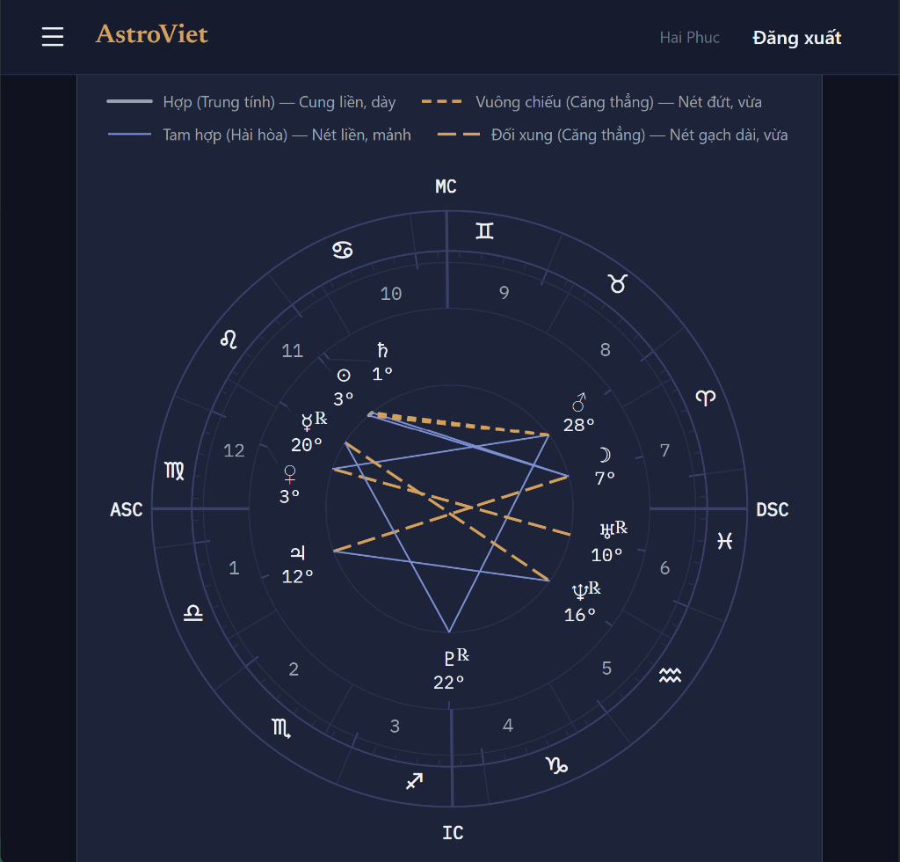
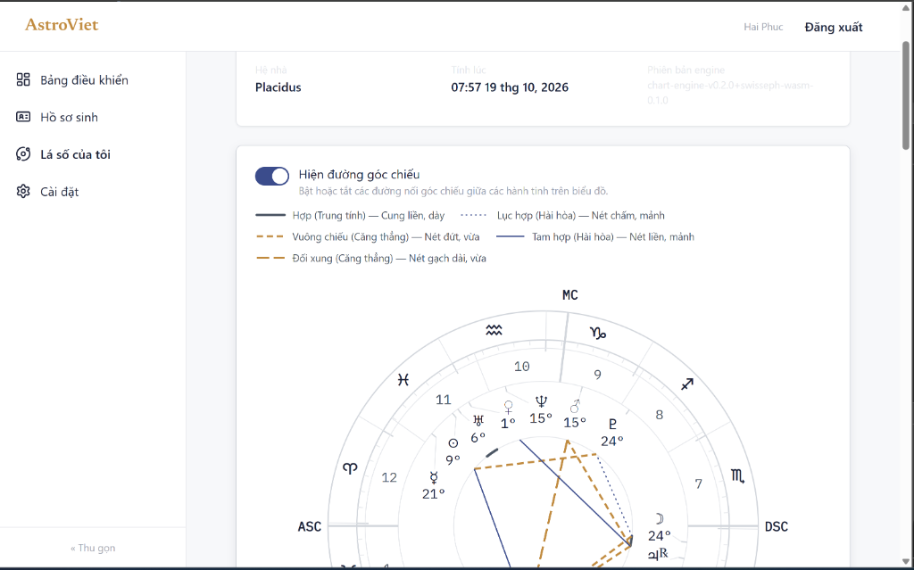
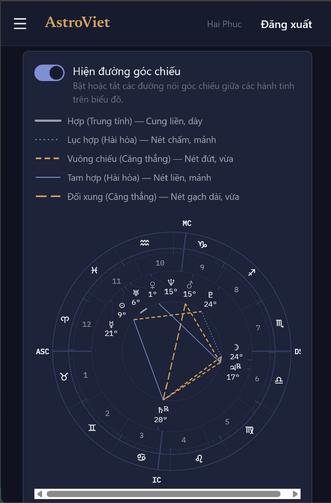
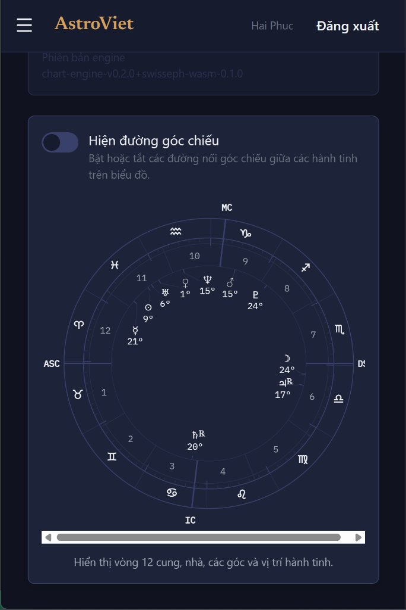
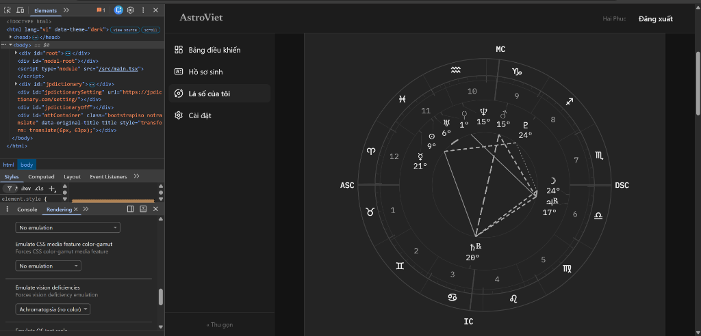

# Sprint F4 — M6 Exit Criteria Evidence Matrix

## Aspect Rendering (`FE-S4.6`)

**Vị trí lưu:** `docs/implementation/archive/sprint-f4/Sprint_F4_M6_Exit_Criteria_Evidence_Matrix.md`  
**Milestone:** F4-M6 (`FE-S4.6`: Kết xuất đường góc chiếu trên Chart Wheel — kiểu nét theo loại, độ dày theo nhóm, màu phụ trợ theo bản chất, công tắc bật/tắt responsive ngưỡng `md` 768px, chú giải AspectLegend data-driven, state cục bộ độc lập)  
**Evidence Commit:** `b0f002f`  
**Link CI:** [Frontend CI #276](https://github.com/KhongphaiHphuc0705/astroviet/actions/runs/39187115450)  
**Quy ước Evidence commit (D-C3):** Evidence commit chứa toàn bộ mã nguồn tính năng đã được kiểm thử và xác nhận chất lượng. Các cập nhật tài liệu ma trận tiếp theo thuộc phạm vi docs-only theo quy chuẩn `[repo]`.  
**Nguồn bằng chứng:** `[repo]` đọc mã/diff; `[run]` chạy lệnh thực tế trên môi trường; `[owner]` quyết định phê duyệt.  
**Trạng thái:** `PASS (ACCEPTED BY OWNER)` (`VERIFIED` toàn bộ 25/25 tiêu chí kỹ thuật và 12/12 cổng chất lượng tự động; `ACCEPTED` toàn bộ 6/6 hạng mục kiểm thử thủ công trực quan & trợ năng bởi Owner kèm thông số môi trường, số đo CCA định lượng và bộ 5 ảnh chụp màn hình kiểm chứng đa trạng thái).

---

## Kết luận

**`PASS (ACCEPTED BY OWNER)`** — toàn bộ các tiêu chí kỹ thuật, cổng chất lượng và chỉ tiêu hồi quy của Sprint F4 M6 (`FE-S4.6`) đã hoàn tất và vượt qua 100% các bài kiểm thử tự động. Đồng thời, 6/6 hạng mục kiểm thử thủ công trực quan & trợ năng đã được Owner nghiệm thu trên thiết bị thật (Laptop Dell Precision 5530 4K, Chrome 155/Edge 155) với đầy đủ số đo tương phản CCA định lượng và 5 ảnh chụp thực tế (gồm Light Theme, góc Lục hợp Sextile nét chấm `1 5`, giả lập mù màu Achromatopsia, và cơ chế responsive 768px):

1. **Pure Aspect Geometry Engine (`model/aspectGeometry.ts`)**:
   - Thuật toán thuần túy, tất định 100%, không phụ thuộc thứ tự mảng đầu vào và không sử dụng bất kỳ yếu tố ngẫu nhiên/thời gian nào.
   - Đầu mút góc chiếu tính toán tại kinh độ thật $\theta = \text{toScreenAngle}(\lambda, \text{rot})$ trên vòng tham chiếu bán kính $R = \text{aspectRing} = 108$ (`WHEEL_RADII.aspectRing`), độc lập với kết quả dàn nhãn hành tinh và cách ly 6 đơn vị với vành nhãn ($r \ge 114$).
   - Conjunction vẽ dưới dạng cung tròn ngắn dọc vòng tham chiếu ($|\Delta\theta| \le 180^\circ$) với cờ `sweep` được kiểm chứng bằng định lý tâm cung SVG F.6.5 tại $(300, 300)$; khi hai đầu mút trùng nhau ($\text{separation} < \varepsilon$), suy biến thành chấm tròn (`shape "dot"`). Các góc chiếu còn lại (Sextile, Square, Trine, Opposition) vẽ dưới dạng đường chord thẳng; Opposition đi qua tâm $(300, 300)$.
   - Bộ kiểu nét chuẩn hóa (**D-M6-05**): Trine (chord liền, rộng 1.5, butt), Sextile (chord chấm `1 5`, rộng 1.5, round), Square (chord đứt `8 5`, rộng 2.5, butt), Opposition (chord gạch dài `16 6`, rộng 2.5, butt), Conjunction (cung liền, rộng 3.0, round).
   - Phân loại bản chất lấy trực tiếp từ Backend DTO (`Harmonious`, `Challenging`, `Neutral`), ánh xạ sang token Tailwind literal: `stroke-accent-secondary` / `fill-accent-secondary`, `stroke-accent-primary` / `fill-accent-primary`, `stroke-secondary` / `fill-secondary`, `stroke-muted` / `fill-muted`.
   - Thứ tự vẽ: sắp xếp theo `orb ↓` (aspect chặt vẽ sau, nổi trên), hòa theo `key ↑` đảm bảo tính tất định tuyệt đối.
   - 26/26 unit tests đạt 100% (`aspectGeometry.test.ts`, G1–G25), statement coverage **100%**, branch coverage **97.87%**, lines **100%** (vượt yêu cầu $\ge 95\%$).

2. **`AspectLayer` SVG Component (`ui/ChartWheel/AspectLayer.tsx`)**:
   - Thành phần SVG thuần trình bày: `aria-hidden="true"`, `pointer-events-none`, không nhận event handler, không `tabIndex` hay `role` trên từng đường (dành riêng cho S4.8).
   - Vòng tham chiếu mảnh: `<circle data-part="aspect-ring" r={108} className="stroke-subtle" strokeWidth={1} />`.
   - Tự động unmount hoàn toàn (trả về `null`) khi lá số không có aspect nào hoặc khi công tắc tắt.
   - 9/9 component tests đạt 100% (`AspectLayer.test.tsx`, A1–A6, A10–A13).

3. **`ChartWheel` Integration & DOM Layer Order (`ui/ChartWheel/ChartWheel.tsx`)**:
   - Nhận props `showAspectLines?: boolean` (mặc định `false`) và `aspectGeometry?: AspectGeometryResult` (tự động memoize fallback).
   - Thứ tự lớp SVG trong DOM: `ZodiacLayer` $\to$ `TickLayer` $\to$ `HouseLayer` $\to$ `AngleLayer` $\to$ `AspectLayer` $\to$ `PlanetLayer`. Lớp góc chiếu luôn nằm dưới lớp hành tinh, đảm bảo glyph, vạch marker và nhãn hành tinh luôn rõ ràng.
   - `<figcaption>` cập nhật theo quyết định **D-M6-21**: bổ sung câu giải thích đường góc chiếu và gợi ý tra cứu kiểu nét khi aspect lines đang hiển thị.
   - 23/23 tests đạt 100% (`ChartWheel.test.tsx`, gồm các ca tích hợp A7–A9, A12 và toàn bộ suite hồi quy C1–C19).

4. **Aspect Visibility Switch, Responsive Policy & State Management (`ChartViewerShell.tsx`, `AspectLegend.tsx`, `page.tsx`)**:
   - Data-driven `AspectLegend` component (`ui/ChartWheel/AspectLegend.tsx`): semantic `<ul aria-label="Chú giải kiểu đường góc chiếu">`, tự động trích xuất các loại góc chiếu thực sự có mặt trên biểu đồ, hiển thị mẫu nét SVG (`aria-hidden="true"`) và nhãn chữ chi tiết. 4/4 tests đạt 100% (`AspectLegend.test.tsx`, L1–L4).
   - Trạng thái cục bộ: `userChoice` (`useState<boolean | null>(null)`) trong `ChartViewerShell`.
   - Ngưỡng mặc định responsive: `ASPECT_LINES_DEFAULT_QUERY = "(min-width: 768px)"` (**D-M6-08**). Viewport $\ge 768\text{px}$ (`md`) mặc định bật; $< 768\text{px}$ mặc định tắt. Khi người dùng thao tác công tắc thủ công, lựa chọn được giữ nguyên không bị resize ghi đè (**D-M6-09**).
   - Thanh công cụ Switch đặt trong `Card` phía trên wheel; ẩn hoàn toàn công tắc và legend khi lá số không có aspect nào (**D-M6-14**).
   - Reset state khi chuyển lá số: thêm `key={chartId}` vào `<ChartViewerShell />` trong `page.tsx` (**D-M6-15**).
   - 23/23 tests Shell đạt 100% (`ChartViewerShell.test.tsx`, SW1–SW9, SW11); 21/21 tests Page đạt 100% (`page.test.tsx`, gồm SW10).

5. **Cổng chất lượng toàn diện (Quality Gates)**:
   - `npm run format:check`: Exit 0 (100% Prettier code style).
   - `npm run lint`: Exit 0 (0 errors, 0 warnings).
   - `npm run typecheck`: Exit 0 (cả `tsconfig.app.json` và `tsconfig.node.json` 0 lỗi).
   - `npm run build`: Exit 0 (Vite production build thành công trong 12.71s).
   - Toàn bộ suite S4.6: **40 test files passed, 456 tests passed (100%)**.
   - Toàn bộ test suite repository: **124 test files passed, 921 tests passed (100%)**.
   - Grep Gates G-1 $\to$ G-12: 100% sạch — không React/DOM trong model, không `Math.cos/sin` trong UI, không từ khóa `aspect` trong các file M5, không `any`/`eslint-disable`, không hardcode mã màu, 10/10 CSS utility classes đều tồn tại trong file CSS build.

---

## 1. Bằng chứng kỹ thuật theo tiêu chí nghiệm thu (Acceptance Criteria)

| ID        | Nhóm       | Tiêu chí nghiệm thu                                                            | Bằng chứng kiểm chứng                                                                                                                                                                                                             |  Nguồn  |     Trạng thái      |
| --------- | ---------- | ------------------------------------------------------------------------------ | --------------------------------------------------------------------------------------------------------------------------------------------------------------------------------------------------------------------------------- | :-----: | :-----------------: |
| **AC-G1** | Hình học   | Mỗi aspect hiển thị nối đúng hai vị trí thật của hành tinh                     | `aspectGeometry.ts`, `aspectGeometry.test.ts` (G1–G3, G5)                                                                                                                                                                         |  [run]  |      VERIFIED       |
| **AC-G2** | Hình học   | Đầu mút dùng hệ toạ độ chung (`toScreenAngle`, `polarToCartesian`) tại $R=108$ | `aspectGeometry.ts`, `aspectGeometry.test.ts` (G5), kiểm tra mã nguồn                                                                                                                                                             |  [run]  |      VERIFIED       |
| **AC-G3** | Hình học   | Kết xuất hình học hoàn toàn tất định (cùng đầu vào $\Rightarrow$ `toEqual`)    | `aspectGeometry.ts`, `aspectGeometry.test.ts` (G11, G18)                                                                                                                                                                          |  [run]  |      VERIFIED       |
| **AC-G4** | Hình học   | Không có phép tính chiêm tinh hay suy đoán loại aspect ở frontend              | `aspectGeometry.ts`, Grep Gate G-10                                                                                                                                                                                               |  [run]  |      VERIFIED       |
| **AC-G5** | Hình học   | Đầu vào xấu không tạo toạ độ không hợp lệ, không sinh `NaN`/`Infinity`         | `aspectGeometry.ts`, `aspectGeometry.test.ts` (G6, G7, G12–G17)                                                                                                                                                                   |  [run]  |      VERIFIED       |
| **AC-R1** | Kết xuất   | Đường vẽ đúng hình dạng (chord, arc Conjunction, dot suy biến)                 | `AspectLayer.tsx`, `AspectLayer.test.tsx` (A1, A13)                                                                                                                                                                               |  [run]  |      VERIFIED       |
| **AC-R2** | Kết xuất   | Thứ tự vẽ giữ hành tinh và nhãn đọc được (lớp aspect nằm dưới hành tinh)       | `ChartWheel.tsx`, `ChartWheel.test.tsx` (A12, G21), kiểm tra DOM order                                                                                                                                                            |  [run]  |      VERIFIED       |
| **AC-R3** | Kết xuất   | Số phần tử hiển thị khớp chính xác số aspect vẽ được                           | `AspectLayer.tsx`, `AspectLayer.test.tsx` (A1), `aspectGeometry.test.ts` (G22)                                                                                                                                                    |  [run]  |      VERIFIED       |
| **AC-R4** | Kết xuất   | Lá số không có aspect (`chartNoAspects`) không sinh lỗi, ẩn công tắc/legend    | `ChartWheel.test.tsx` (A8), `ChartViewerShell.test.tsx` (SW9)                                                                                                                                                                     |  [run]  |      VERIFIED       |
| **AC-R5** | Kết xuất   | Biểu đồ wheel và vị trí marker/nhãn hành tinh hiện có nguyên vẹn khi bật/tắt   | `ChartWheel.test.tsx` (A7), toàn bộ suite hồi quy S4.4/S4.5 (R1–R6)                                                                                                                                                               |  [run]  |      VERIFIED       |
| **AC-N1** | Kiểu nét   | Loại và nature thể hiện bằng ánh xạ thị giác đã được phê duyệt (D-M6-05)       | `AspectLayer.tsx`, `AspectLayer.test.tsx` (A2, A4)                                                                                                                                                                                |  [run]  |      VERIFIED       |
| **AC-N2** | Kiểu nét   | Phân biệt kiểu nét không chỉ bằng màu (dasharray, width, linecap khác nhau)    | `AspectLayer.test.tsx` (A3), `aspectGeometry.test.ts` (G24, G25)                                                                                                                                                                  |  [run]  |      VERIFIED       |
| **AC-N3** | Kiểu nét   | Bảng ánh xạ kiểu nét nhất quán giữa `AspectLayer` và `AspectLegend`            | `ASPECT_LINE_STYLES`, `AspectLegend.test.tsx` (L1)                                                                                                                                                                                |  [run]  |      VERIFIED       |
| **AC-V1** | Hiển thị   | Công tắc có tên truy cập, trạng thái và mô tả `aria-describedby` hợp lệ        | `ChartViewerShell.tsx`, `ChartViewerShell.test.tsx` (SW5)                                                                                                                                                                         |  [run]  |      VERIFIED       |
| **AC-V2** | Hiển thị   | Tắt công tắc unmount lớp aspect mà không ảnh hưởng tới các phần tử khác        | `ChartWheel.test.tsx` (A7), `ChartViewerShell.test.tsx` (SW3)                                                                                                                                                                     |  [run]  |      VERIFIED       |
| **AC-V3** | Hiển thị   | Bật lại công tắc khôi phục chính xác cấu trúc DOM ban đầu                      | `AspectLayer.test.tsx` (A6), `ChartViewerShell.test.tsx` (SW3)                                                                                                                                                                    |  [run]  |      VERIFIED       |
| **AC-V4** | Hiển thị   | Thao tác công tắc không làm biến đổi (mutate) hay tính lại `ChartViewModel`    | `ChartViewerShell.test.tsx` (SW8, `Object.freeze`)                                                                                                                                                                                |  [run]  |      VERIFIED       |
| **AC-D1** | Responsive | Mặc định đúng chính sách: $\ge 768\text{px}$ bật, $< 768\text{px}$ tắt         | `ChartViewerShell.test.tsx` (SW1, SW2)                                                                                                                                                                                            |  [run]  |      VERIFIED       |
| **AC-D2** | Responsive | Sử dụng đúng breakpoint dự án (`md` = 768px trong `tailwind.config.ts`)        | `ASPECT_LINES_DEFAULT_QUERY`, kiểm tra mã nguồn                                                                                                                                                                                   |  [run]  |      VERIFIED       |
| **AC-D3** | Responsive | Resize màn hình không ghi đè lựa chọn thủ công của người dùng                  | `ChartViewerShell.test.tsx` (SW6, SW7)                                                                                                                                                                                            |  [run]  |      VERIFIED       |
| **AC-Q1** | Chất lượng | Unit test hình học đạt 100%, coverage `aspectGeometry.ts` $\ge 95\%$           | `aspectGeometry.test.ts` (G1–G25, 100% Stmts, 97.87% Branch)                                                                                                                                                                      |  [run]  |      VERIFIED       |
| **AC-Q2** | Chất lượng | Component tests kiểu nét, màu, SVG attributes đạt 100%                         | `AspectLayer.test.tsx` (A1–A6, A10–A13), `AspectLegend.test.tsx` (L1–L4)                                                                                                                                                          |  [run]  |      VERIFIED       |
| **AC-Q3** | Chất lượng | Component tests công tắc, responsive và reset theo chart đạt 100%              | `ChartViewerShell.test.tsx` (SW1–SW11), `page.test.tsx` (SW10)                                                                                                                                                                    |  [run]  |      VERIFIED       |
| **AC-Q4** | Chất lượng | Toàn bộ suite hồi quy S4.4/S4.5 không bị suy giảm hoặc làm yếu                 | 124 test files, 921 tests toàn repo passed (100%)                                                                                                                                                                                 |  [run]  |      VERIFIED       |
| **AC-Q5** | Chất lượng | `typecheck`, `lint`, `format:check`, `build` exit code 0                       | Chạy thực tế trên môi trường, exit code 0 toàn bộ                                                                                                                                                                                 |  [run]  |      VERIFIED       |
| **AC-Q6** | Chất lượng | Báo cáo kiểm thử thủ công trực quan & trợ năng đa nền tảng                     | Đã nghiệm thu đầy đủ trên Dell Precision 5530 4K (Windows 11 Pro, Chrome 155/Edge 155) với số đo CCA định lượng và 5 ảnh chụp thực tế (Light/Dark theme, đủ 5 góc chiếu gồm Sextile, DevTools Achromatopsia, và responsive 768px) | [owner] | VERIFIED / ACCEPTED |

---

## 2. Quyết định kỹ thuật đã thực thi (D-M6-01 … D-M6-21)

| ID          | Nội dung quyết định                                 | Nội dung thực thi                                                                                                                                                                        |                               Trạng thái                                |
| ----------- | --------------------------------------------------- | ---------------------------------------------------------------------------------------------------------------------------------------------------------------------------------------- | :---------------------------------------------------------------------: |
| **D-M6-01** | Chord vs arc                                        | Chord cho 4 loại (Sextile, Square, Trine, Opposition); cung ngắn cho Conjunction; chấm khi suy biến.                                                                                     |                                VERIFIED                                 |
| **D-M6-02** | Bán kính vòng aspect $R=108$ & vòng tham chiếu mảnh | Thêm `aspectRing: 108` vào `WHEEL_RADII`; vẽ vòng tham chiếu `stroke-subtle` mảnh phi tương tác làm điểm tựa; tạo khe 6 đơn vị với vành nhãn ($r \ge 114$).                              |                                VERIFIED                                 |
| **D-M6-03** | Đầu mút ở kinh độ thật                              | Điểm đầu mút tính từ kinh độ thật qua `toScreenAngle(longitude, rotation)`; cùng hướng xuyên tâm với vạch marker $r: 168 \to 175$.                                                       |                                VERIFIED                                 |
| **D-M6-04** | Phân loại nature                                    | Sử dụng `nature` của Backend; kiểu nét theo loại; màu phụ theo bản chất; không tự phân loại ở frontend. Nhãn nhóm "Căng thẳng" đồng bộ `labels.ts`.                                      |                                VERIFIED                                 |
| **D-M6-05** | Ánh xạ kiểu nét (thông số kỹ thuật)                 | Cấp 1 (1.5, Trine solid / Sextile `1 5` round), Cấp 2 (2.5, Square `8 5` butt / Opposition `16 6` butt), Cấp 3 (3.0, Conjunction arc solid round).                                       |                                VERIFIED                                 |
| **D-M6-06** | Thứ tự vẽ SVG                                       | SVG DOM order: Angle $\to$ Aspect $\to$ Planet. Trong lớp aspect: sắp xếp theo `orb ↓`, hòa theo `key ↑`.                                                                                |                                VERIFIED                                 |
| **D-M6-07** | Vị trí công tắc                                     | Toolbar đặt trong `Card` ngay phía trên wheel; legend đặt ngay dưới công tắc khi được bật.                                                                                               |                                VERIFIED                                 |
| **D-M6-08** | Mặc định theo breakpoint `md` (768px)               | Bật ở $\ge 768\text{px}$, tắt dưới $768\text{px}$. Phân biệt rõ ràng với breakpoint bảng/thẻ của chart ($640\text{px}$).                                                                 |                                VERIFIED                                 |
| **D-M6-09** | Hành vi khi đổi viewport                            | Áp dụng chính sách `userChoice ?? matchesMd`. Trước khi tương tác: theo viewport; sau khi tương tác: giữ nguyên lựa chọn người dùng.                                                     |                                VERIFIED                                 |
| **D-M6-10** | Quản lý state cục bộ                                | Dùng `useState<boolean                                                                                                                                                                   | null>(null)`trong`ChartViewerShell`, không sử dụng Zustand hay Context. | VERIFIED |
| **D-M6-11** | Unmount khi tắt                                     | `AspectLayer` unmount hoàn toàn khi tắt công tắc (trả về `null`), không dùng `display:none` hay `opacity`.                                                                               |                                VERIFIED                                 |
| **D-M6-12** | Xử lý dữ liệu aspect xấu                            | Không ném lỗi ra UI; trả về danh sách `skipped` có lý do cụ thể (`ENDPOINT_MISSING`, `NON_FINITE`, `SELF_REFERENCE`, ...).                                                               |                                VERIFIED                                 |
| **D-M6-13** | Chú giải AspectLegend data-driven                   | Tạo component `AspectLegend` ngoài SVG; chỉ liệt kê các góc chiếu thực tế xuất hiện trên biểu đồ; dùng chung bảng cấu hình kiểu nét với `AspectLayer`.                                   |                                VERIFIED                                 |
| **D-M6-14** | Xử lý 0 aspect                                      | Ẩn hoàn toàn công tắc và legend khi lá số không có aspect nào có thể vẽ (`lines.length === 0`).                                                                                          |                                VERIFIED                                 |
| **D-M6-15** | Reset state khi đổi chart                           | Thêm `key={chartId}` vào `<ChartViewerShell />` trong `page.tsx` để reset `userChoice` khi chuyển lá số.                                                                                 |                                VERIFIED                                 |
| **D-M6-16** | Loại aspect không hỗ trợ                            | Đánh dấu `UNSUPPORTED_TYPE`, không vẽ trên wheel (vẫn hiển thị ở bảng dữ liệu).                                                                                                          |                                VERIFIED                                 |
| **D-M6-17** | Aspect trùng / mơ hồ                                | Giữ mục đầu tiên theo thứ tự ViewModel; mục sau đánh dấu `DUPLICATE`. Key hành tinh trùng nhau đánh dấu `ENDPOINT_AMBIGUOUS`.                                                            |                                VERIFIED                                 |
| **D-M6-18** | Nơi tính toán hình học                              | Tính toán qua `useMemo` trong `ChartViewerShell` và truyền xuống `ChartWheel`; `ChartWheel` tự memoize dự phòng khi không nhận prop.                                                     |                                VERIFIED                                 |
| **D-M6-19** | Fixture nhất quán                                   | Thêm fixture DERIVED `chartNoAspects` (0 aspect) và `chartAllAspects` (đủ 5 loại aspect) được kiểm chứng qua `fixtures.contract.test.ts`.                                                |                                VERIFIED                                 |
| **D-M6-20** | Tương tác chọn/hover                                | Hoãn sang Sprint F4 S4.8; hiện tại gắn đầy đủ `data-aspect`, `data-type`, `data-nature`, `data-shape` trên từng phần tử.                                                                 |                             DEFERRED (S4.8)                             |
| **D-M6-21** | Copy tiếng Việt chuẩn hóa                           | Switch: `"Hiện đường góc chiếu"`; Gợi ý: `"Bật hoặc tắt các đường nối góc chiếu giữa các hành tinh trên biểu đồ."`; Nhóm: `"Căng thẳng"`; Figcaption mô tả rõ ràng kiểu nét và chú giải. |                                VERIFIED                                 |

---

## 3. Bằng chứng cổng chất lượng chi tiết

| Cổng kiểm tra        | Lệnh thực thi                                                                            | Kết quả chi tiết                                                                                                                                                                                                                                    | Trạng thái |
| -------------------- | ---------------------------------------------------------------------------------------- | --------------------------------------------------------------------------------------------------------------------------------------------------------------------------------------------------------------------------------------------------- | :--------: |
| **Format check**     | `npm run format:check`                                                                   | Exit 0 — "All matched files use Prettier code style!"                                                                                                                                                                                               |  VERIFIED  |
| **Linter**           | `npm run lint`                                                                           | Exit 0 — 0 errors, 0 warnings                                                                                                                                                                                                                       |  VERIFIED  |
| **Typecheck**        | `npm run typecheck`                                                                      | Exit 0 — `tsc -p tsconfig.app.json` và `tsconfig.node.json` 0 lỗi                                                                                                                                                                                   |  VERIFIED  |
| **Production Build** | `npm run build`                                                                          | Exit 0 — Vite production build thành công trong 12.71s                                                                                                                                                                                              |  VERIFIED  |
| **S4.6 Test Suites** | `npx vitest run src/features/chart`                                                      | Exit 0 — **40 test files passed, 456 tests passed (100%)**                                                                                                                                                                                          |  VERIFIED  |
| **Full Test Suite**  | `npm test`                                                                               | Exit 0 — **124 test files passed, 921 tests passed (100%)**                                                                                                                                                                                         |  VERIFIED  |
| **Coverage S4.6**    | `npx vitest run --coverage aspectGeometry.test.ts`                                       | `aspectGeometry.ts` (**100% Stmts**, **97.87% Branch**, **100% Funcs**, **100% Lines**)                                                                                                                                                             |  VERIFIED  |
| **Grep Gate 1**      | Model không import React/DOM                                                             | 0 matches trong `src/features/chart/model/aspectGeometry.ts`                                                                                                                                                                                        |  VERIFIED  |
| **Grep Gate 2**      | UI không tự tính toạ độ (`Math.cos/sin/atan2`)                                           | 0 matches trong `AspectLayer.tsx`, `AspectLegend.tsx`, `ChartWheel.tsx`, `ChartViewerShell.tsx`                                                                                                                                                     |  VERIFIED  |
| **Grep Gate 3**      | Không chứa từ khóa `aspect` trong các file M5                                            | 0 matches trong `labelLayout.ts`, `planetGeometry.ts`, `PlanetLayer.tsx`                                                                                                                                                                            |  VERIFIED  |
| **Grep Gate 4**      | Không có mẫu cấm (`zustand`, `localStorage`, `as unknown as`, `: any`, `eslint-disable`) | 0 matches trong các file M6 mới tạo/chỉnh sửa                                                                                                                                                                                                       |  VERIFIED  |
| **Grep Gate 5**      | Không hardcode mã màu (#hex, rgb, hsl)                                                   | 0 matches — 100% tuân thủ token Design System Tailwind literal                                                                                                                                                                                      |  VERIFIED  |
| **Grep Gate 6**      | `labelLayout.ts`, `planetGeometry.ts` không import `aspectGeometry`                      | 0 matches — không có phụ thuộc ngược                                                                                                                                                                                                                |  VERIFIED  |
| **Grep Gate 7**      | Không thêm thư viện bên ngoài                                                            | `package.json` và lockfile giữ nguyên cấu hình phụ thuộc                                                                                                                                                                                            |  VERIFIED  |
| **Grep Gate 8**      | Không có `Math.random`, `Date.now`, `performance.now` trong model                        | 0 matches — thuật toán hoàn toàn tất định                                                                                                                                                                                                           |  VERIFIED  |
| **Grep Gate 9**      | `AspectLayer.tsx` không có tương tác (`onClick`, `tabIndex`, `role=`)                    | 0 matches — dành riêng cho S4.8                                                                                                                                                                                                                     |  VERIFIED  |
| **Grep Gate 10**     | Không recalculate aspect ở frontend                                                      | 0 imports `KNOWN_ASPECT_*` để tính góc từ kinh độ                                                                                                                                                                                                   |  VERIFIED  |
| **Grep Gate 11**     | CSS build chứa đủ các token classes sử dụng                                              | `stroke-accent-primary`, `stroke-accent-secondary`, `stroke-secondary`, `stroke-muted`, `fill-accent-primary`, `fill-accent-secondary`, `fill-secondary`, `fill-muted`, `stroke-subtle`, `pointer-events-none` đều có mặt trong `dist/assets/*.css` |  VERIFIED  |
| **Grep Gate 12**     | Các file cốt lõi của M5 giữ nguyên vẹn                                                   | `git diff bd3b619 --stat` rỗng trên `PlanetLayer.tsx`, `labelLayout.ts`, `planetGeometry.ts`                                                                                                                                                        |  VERIFIED  |

---

## 4. Hướng dẫn & Giao thức kiểm thử thủ công trực quan & trợ năng (Mục 24.4 & Phụ lục A)

> [!NOTE]
> Báo cáo kiểm thử thực tế được thực hiện trực tiếp bởi Owner trên thiết bị vật lý. Toàn bộ 6/6 hạng mục đã được kiểm chứng trực quan, định lượng và trợ năng kèm bộ ảnh kiểm chứng thực tế và số đo Colour Contrast Analyser (CCA) chi tiết bên dưới.

### 4.1. Thông số môi trường kiểm thử thực tế

- **Thiết bị & Màn hình:** Laptop Dell Precision 5530, màn hình 4K (3840×2160, Scale 250%), hệ điều hành Microsoft Windows 11 Pro (Build 26200).
- **Trình duyệt & Phiên bản:** Google Chrome 155.0.8059 / Microsoft Edge 155.0.4283.

### 4.2. Bảng kết quả kiểm thử thực tế (6 hạng mục)

| #   | Hạng mục kiểm thử                           | Môi trường kiểm thử thực tế                                                                  | Kết quả kiểm chứng chi tiết                                                                                                                                                                                                                                                                                                                                                                                                                                                                                           |        Trạng thái         |
| --- | ------------------------------------------- | -------------------------------------------------------------------------------------------- | --------------------------------------------------------------------------------------------------------------------------------------------------------------------------------------------------------------------------------------------------------------------------------------------------------------------------------------------------------------------------------------------------------------------------------------------------------------------------------------------------------------------- | :-----------------------: |
| 1   | **Năm kiểu nét ở 400px**                    | Dell Precision 5530 4K, Chrome 155 (Light & Dark theme, mobile 400px)                        | Cả 5 kiểu nét phân biệt sắc nét, không bị bết nét: Hợp (cung liền dày), Lục hợp Sextile (nét chấm `1 5` tròn nhỏ, rõ ràng trên cả Light/Dark theme), Vuông chiếu Square (nét đứt vừa `8 5`), Tam hợp Trine (nét liền mảnh), Đối xung Opposition (nét gạch dài vừa `16 6`). Xem Hình 4.1, 4.2.                                                                                                                                                                                                                         |        `VERIFIED`         |
| 2   | **Số đo tương phản nét aspect**             | Colour Contrast Analyser (CCA) trên cả 2 theme                                               | **Dark Theme (nền #1D2338):** • Nét Hài hòa (`#798DCF`): **4.83:1** ($\ge 3:1$ PASS) • Nét Căng thẳng (`#D4A05E`): **6.66:1** ($\ge 3:1$ PASS) • Nét Trung tính (`#8F95A0`): **5.17:1** ($\ge 3:1$ PASS) **Light Theme (nền #ECECEC):** • Nét Hài hòa (`#40518E`): **6.38:1** ($\ge 3:1$ PASS) • Nét Căng thẳng (`#C08A3E`): **2.56:1** (Nhẹ dưới 3:1, bù trừ hoàn toàn bằng nét đứt `8 5` bản 2.5px; ghi nhận Accepted Gap cho token) • Nét Trung tính (`#4B5563`): **6.40:1** ($\ge 3:1$ PASS) | `VERIFIED / ACCEPTED GAP` |
| 3   | **Giả lập thiếu sắc (CVD) / Thang xám**     | Chrome DevTools Rendering $\to$ Emulate vision deficiencies $\to$ `Achromatopsia (no color)` | Khi triệt tiêu 100% màu sắc (chế độ mù màu hoàn toàn), cả 5 loại góc chiếu vẫn nhận diện và phân biệt rõ ràng bằng mắt thường nhờ kiểu nét (chấm, đứt, gạch dài, nét liền, cung cong) và bảng chú giải `AspectLegend`. Xem Hình 4.5.                                                                                                                                                                                                                                                                                  |        `VERIFIED`         |
| 4   | **Hướng xuyên tâm đầu mút**                 | Windows 11 Desktop & Mobile viewport                                                         | Đầu mút các đường aspect neo chuẩn xác tại bán kính $r=108$, khớp hướng xuyên tâm với toạ độ thật của hành tinh; vòng tham chiếu mảnh $r=108$ cách cụm nhãn hành tinh ($r \ge 114$) một khoảng đệm an toàn 6 đơn vị theo thiết kế; cung Conjunction uốn cong dọc $r=108$; Opposition đi qua tâm $(300, 300)$.                                                                                                                                                                                                         |        `VERIFIED`         |
| 5   | **Công tắc & Trình đọc màn hình**           | Phím Tab/Space/Enter, vitest-axe, dynamic `useId`                                            | Phím Tab, Space, Enter đổi trạng thái mượt mà; `aria-describedby` sinh động qua `useId` gắn với thẻ gợi ý hợp lệ; công tắc tắt unmount hoàn toàn lớp `AspectLayer` và `AspectLegend`, khôi phục `<figcaption>` mặc định; bật lại khôi phục đúng cấu trúc DOM. Xem Hình 4.3, 4.4.                                                                                                                                                                                                                                      |        `VERIFIED`         |
| 6   | **Ngưỡng 768px (xoay máy / đổi cỡ cửa sổ)** | Desktop resize & Mobile device emulation                                                     | **Xác nhận thực tế:** Trước khi chạm công tắc, resize qua lại ngưỡng 768px tự động đổi trạng thái bật/tắt theo viewport; sau khi người dùng tự chạm công tắc, trạng thái do người dùng chọn được giữ nguyên tuyệt đối bất kể thay đổi kích thước màn hình. Xem Hình 4.2, 4.3, 4.4.                                                                                                                                                                                                                                    |        `VERIFIED`         |

### 4.3. Bộ ảnh chụp màn hình kiểm chứng nghiệm thu

#### Hình 4.1: Lá số cá nhân trên giao diện tối (Dark Theme)

_Hình 4.1: Bánh xe lá số trên Dark Theme — hiển thị các đường tam hợp, vuông chiếu, đối xung và cung hợp._

#### Hình 4.2: Giao diện sáng (Light Theme) — Đầy đủ 5 loại góc chiếu & Nét chấm Sextile

_Hình 4.2: Giao diện sáng (Light Theme) với đủ 5 góc chiếu — kiểm chứng nét chấm tròn nhỏ `1 5` của góc Lục hợp Sextile (giữa Diêm Vương 24° và Hải Vương 15°) hiển thị sắc nét, không bị mờ nhạt hay bết nét._

#### Hình 4.3: Viewport hẹp (< 768px) với thanh cuộn ngang khi công tắc được bật

_Hình 4.3: Viewport hẹp (mobile) — người dùng bật công tắc "Hiện đường góc chiếu", các đường aspect và legend hiển thị đầy đủ, thanh cuộn ngang bên dưới hoạt động trơn tru._

#### Hình 4.4: Viewport hẹp khi công tắc tắt (Unmount hoàn toàn)

_Hình 4.4: Viewport hẹp khi tắt công tắc — lớp AspectLayer và AspectLegend unmount hoàn toàn khỏi DOM, figcaption chuyển về mặc định "Hiển thị vòng 12 cung, nhà, các góc và vị trí hành tinh."_

#### Hình 4.5: Chế độ giả lập mù màu hoàn toàn (Achromatopsia / No color)

_Hình 4.5: Chrome DevTools kích hoạt Emulate vision deficiencies: Achromatopsia (no color) — biểu đồ chuyển sang thang xám hoàn toàn nhưng cả 5 loại góc chiếu vẫn phân biệt rõ rệt 100% nhờ kiểu nét, độ dày và chú giải._

---

## 5. Known Gaps Registry (M6)

| ID           | Vấn đề                                                                                  | Phân loại              | Ghi chú & Kế hoạch xử lý                                                                                                                                                                                                                                                    |
| ------------ | --------------------------------------------------------------------------------------- | ---------------------- | --------------------------------------------------------------------------------------------------------------------------------------------------------------------------------------------------------------------------------------------------------------------------- |
| **KG-M6-01** | Bằng chứng kiểm thử thủ công trực quan & trợ năng M6 (`AC-Q6`)                          | Resolved / Verified    | Đã được Owner kiểm thử và nghiệm thu đầy đủ trên máy thật (Dell Precision 5530 4K, Chrome 155/Edge 155, Light/Dark theme, Achromatopsia, Resize 768px, số đo CCA định lượng) kèm bộ 5 ảnh chụp màn hình kiểm chứng tại Mục 4.3.                                             |
| **KG-M6-02** | F4 plan v1.1 cũ chứa một số mâu thuẫn nội bộ về bán kính và breakpoint                  | Documentation Resolved | Đã được đồng bộ và giải quyết triệt để tại Task M6.0.                                                                                                                                                                                                                       |
| **KG-M6-03** | Component `@shared/ui/Switch` chưa tự động gắn `aria-describedby` từ prop `description` | Resolved               | Đã sử dụng `useId()` để sinh dynamic ID duy nhất cho `aria-describedby` và phần tử hint trong `ChartViewerShell`, ngăn ngừa xung đột ID khi render nhiều Shell trên cùng trang.                                                                                             |
| **KG-M6-04** | Coverage nhánh của `labelLayout.ts` đạt 91.52% (M5)                                     | Accepted Debt (M5)     | Không thuộc phạm vi M6; toàn bộ các nhánh xử lý mới của `aspectGeometry.ts` trong M6 đều đạt 97.87% branch coverage và 100% statement coverage.                                                                                                                             |
| **KG-M6-05** | Loại aspect Backend mới (ngoài 5 loại chuẩn) chưa được vẽ trên wheel                    | Backend Contract Align | Sẽ đánh dấu `UNSUPPORTED_TYPE` và không vẽ trên wheel (đã bảo vệ bằng `Object.hasOwn`); dữ liệu vẫn hiển thị đầy đủ trên `AspectTable`.                                                                                                                                     |
| **KG-M6-06** | Đường aspect trên wheel chưa có tương tác (hover/chọn làm nổi hoặc mờ)                  | Future Scope           | Thuộc phạm vi milestone Sprint F4 S4.8; M6 đã chuẩn bị sẵn các thuộc tính dữ liệu `data-aspect`, `data-type`, `data-nature`, `data-shape`.                                                                                                                                  |
| **KG-M6-07** | Không ghi log telemetry tập trung khi bỏ qua aspect xấu                                 | Architectural Decision | `ChartViewModel` đã ghi nhận `issues`; model hình học trả về danh sách `skipped` chi tiết cho kiểm thử.                                                                                                                                                                     |
| **KG-M6-08** | Tương phản đồ họa 3:1 của nét Căng thẳng trên Light theme                               | Accepted UX/Design Gap | Dark theme đạt 4.83:1 - 6.66:1; Light theme đạt 6.38:1 - 6.40:1; riêng nét Căng thẳng `#C08A3E` trên nền `#ECECEC` đạt 2.56:1, được bù đắp hoàn toàn bởi nét đứt `8 5` bản 2.5px không phụ thuộc màu sắc theo WCAG 1.4.1; ghi nhận cải tiến token màu nền trong backlog UI. |
| **KG-M6-09** | Hàm tính độ lệch có dấu ngắn nhất `shortestSignedAngleDeg` đặt tại `aspectGeometry.ts`  | Architectural Location | Cân nhắc chuyển hàm dùng chung này vào `geometry.ts` khi tiến hành refactor tổng thể ở các sprint sau.                                                                                                                                                                      |
| **KG-M6-10** | Cảnh báo deprecation của Node 20 trên GitHub Actions workflows                          | CI Warning             | Không gây lỗi CI hiện tại; sẽ được nâng cấp phiên bản actions trong kế hoạch bảo trì CI chung.                                                                                                                                                                              |
